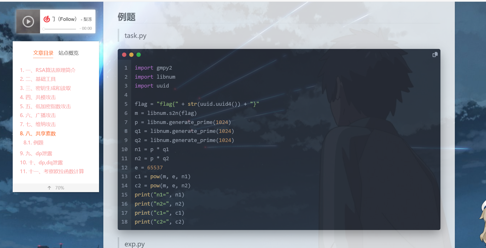
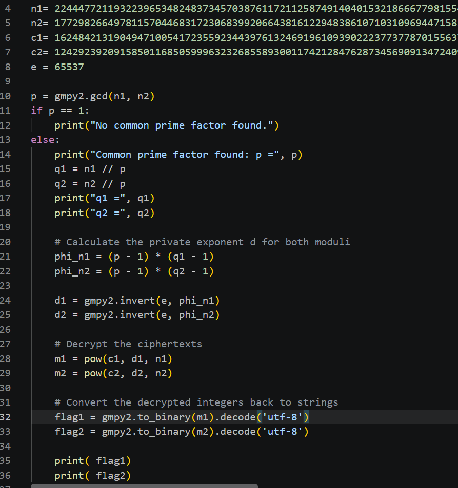
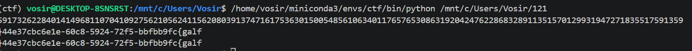
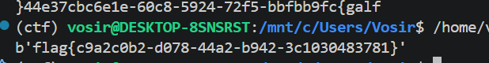
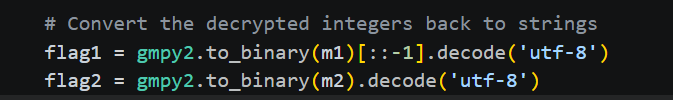
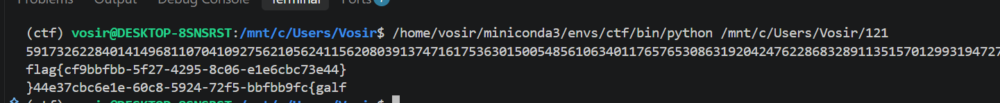
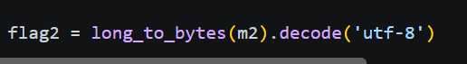
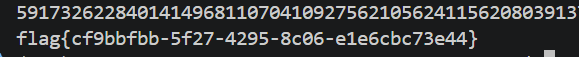

1. 共享素数

当 N1=p\*q1

N2 = p\*q2

两个模，共用p时

求最大公约数得P

发现共享 p，尝试攻击

运行作者题目得到n1,n2,c1,c2

编写脚本，借助软件自动补齐

运行

奇怪，与参考答案不匹配

Ai询问，发现刚好反了

得知原因是大小序列不匹配，作者用的大序列

我们直接改正生成的，（ai查询得知，叫切片反转）

好了

**感受：.gcd操作求得最大公因数，共用的p，再分别去求得q1,q2,再算对应欧拉值，拿来求逆元，再pow,模幂运算解密，转码得flag**

*附件：尝试了别的函数（大序列）*

*问题也解决了*

*10.13.2026，；罗渊默，学习共享素数*
