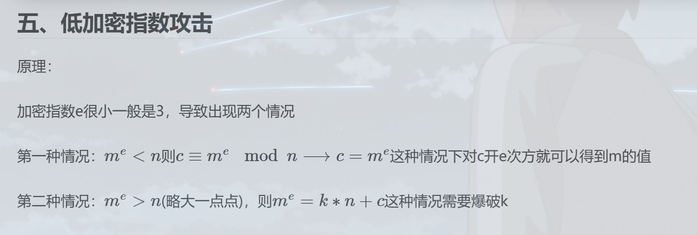

理解

对第一种，当m^e还没有n大，与c同余，则直接是c，余为c

对第二种，当m^e比n大，与c同余，丢掉最多的n(K个)，余c(K从1开始一个个试（爆破）)

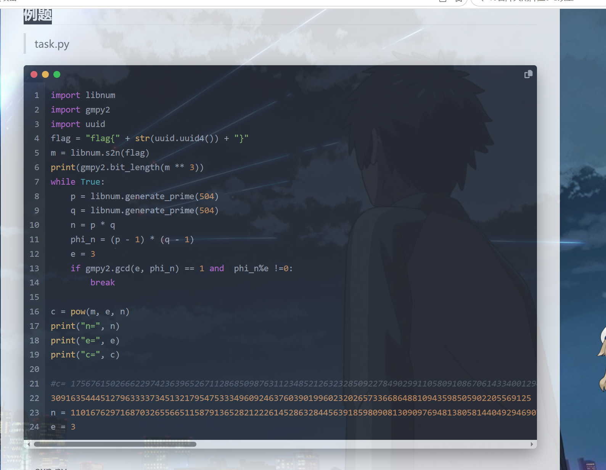

依旧先运行，拿到c,n,e

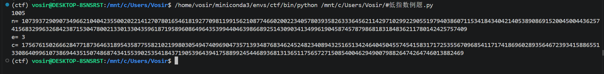

E怎么这么小，试试，低加密指数攻击

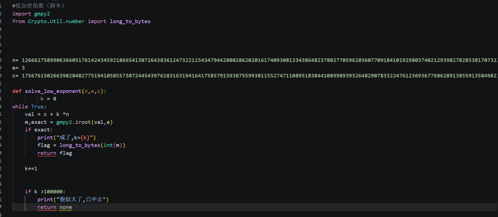

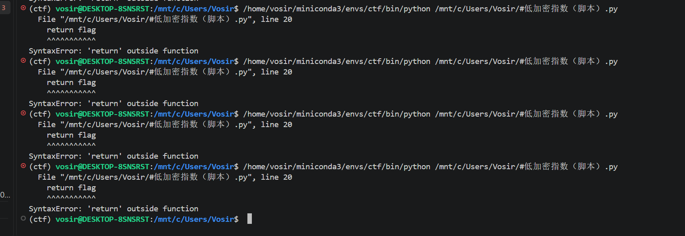碰到一堆缩进错误，位置问题。。。。。

自己与ds协力修复问题

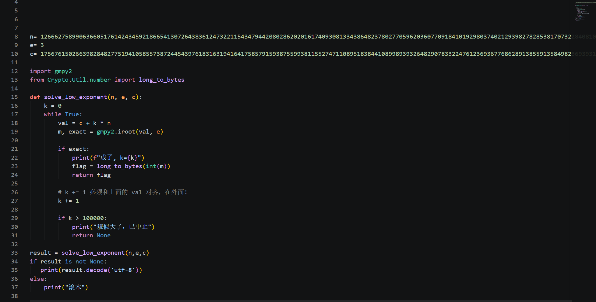

尝试中，貌似出来了

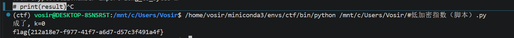

对官方答案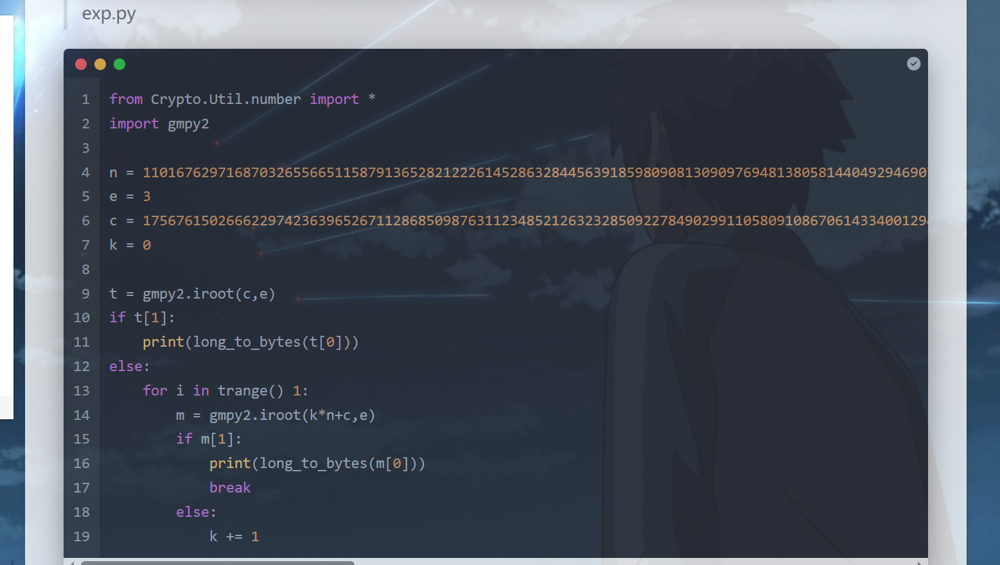 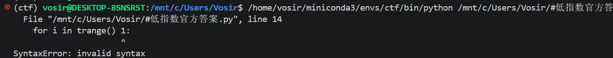

他的怎么报错了，问问

查询

**1,for循环**

**For 变量 in 可迭代对象：（不可敲1）**

**2,Trange 在tqdm库中，未调用**

**3,else:k+=1乱了，在for循环中**

改改（ds辅助）

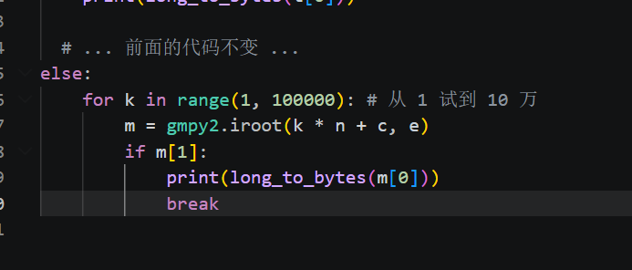

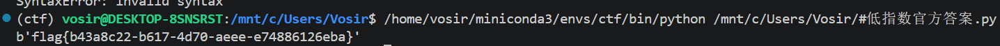

嗯，没问题了？

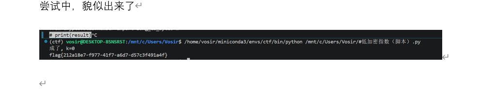

为什么不一样？？？

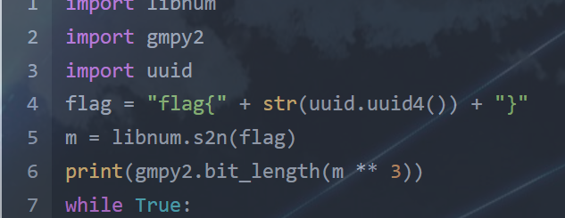

查询得知uuid的锅，这是随机生成成分。。。。。

我也对了，不过作者与我的n不同。。。。。

太好了

**总结：1，不要太迷信官方答案。。。还真不一定跑得通，尽信书不如无书。。**

**2，python缩进是个问题。。。**

**3，uuid,random,os.urandom,这样的是随机生成成分，以后打靶场会见到**

**4，整体解决方案，从k=0开始（这样就不要分类讨论，直接跑）**

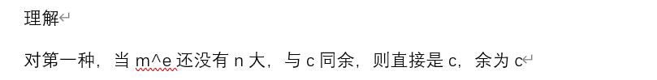

**因为此时K=0**

*10.17.2026，；罗渊默，学习    低加密指数攻击*
