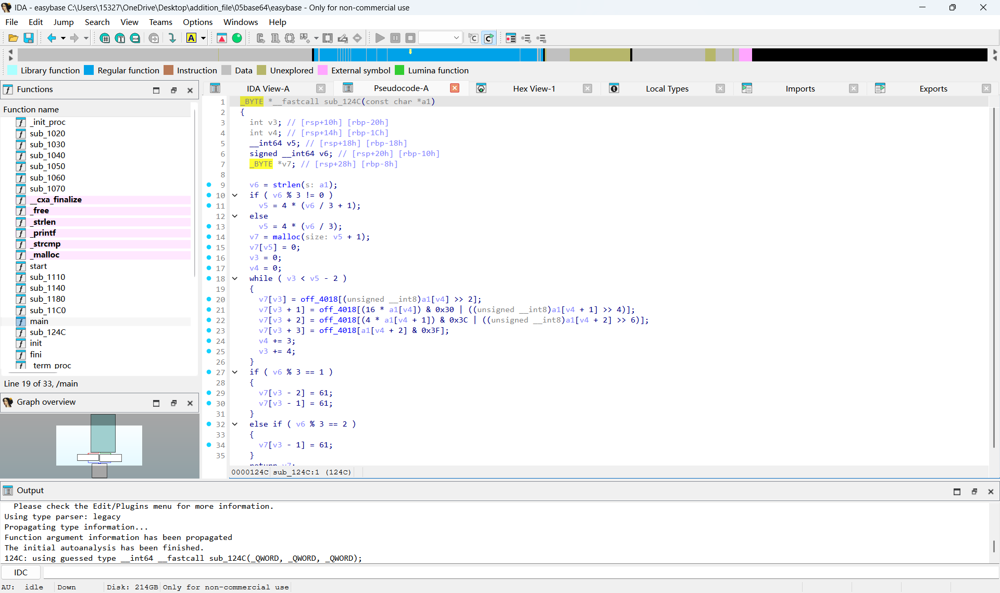
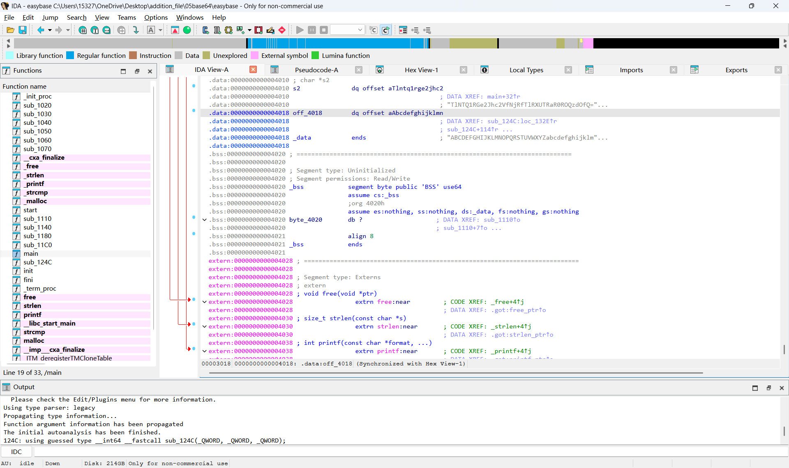
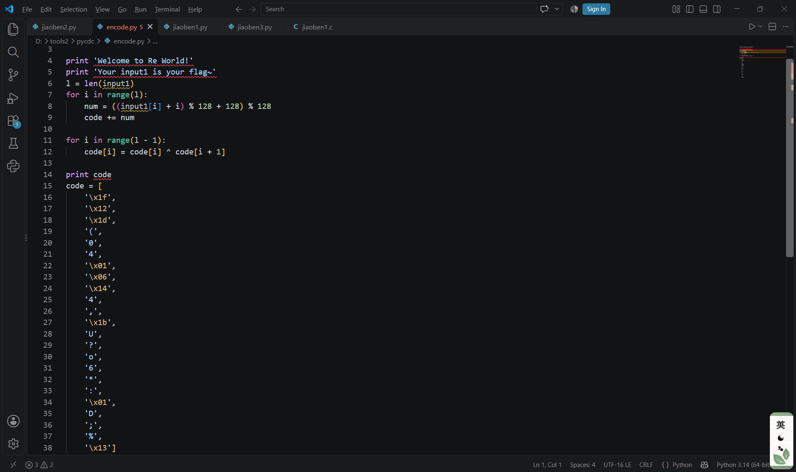
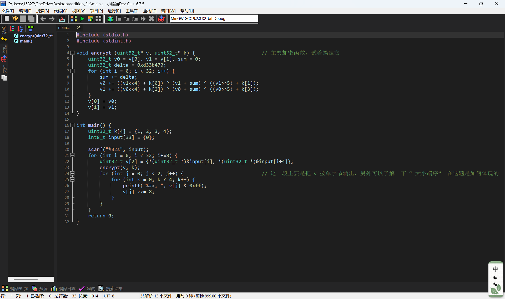
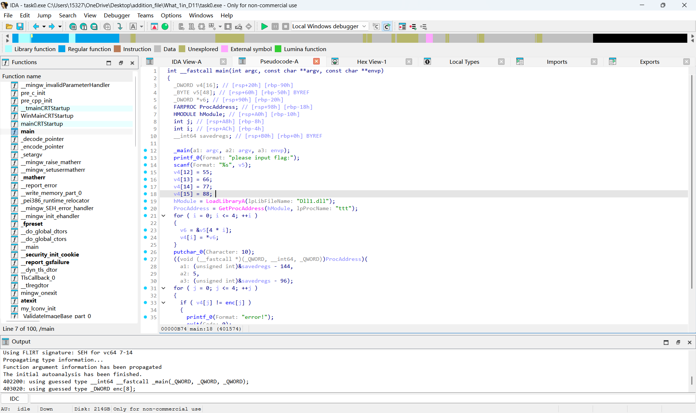
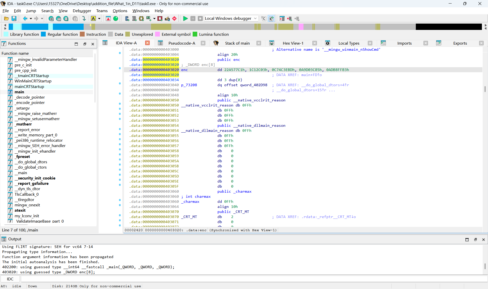
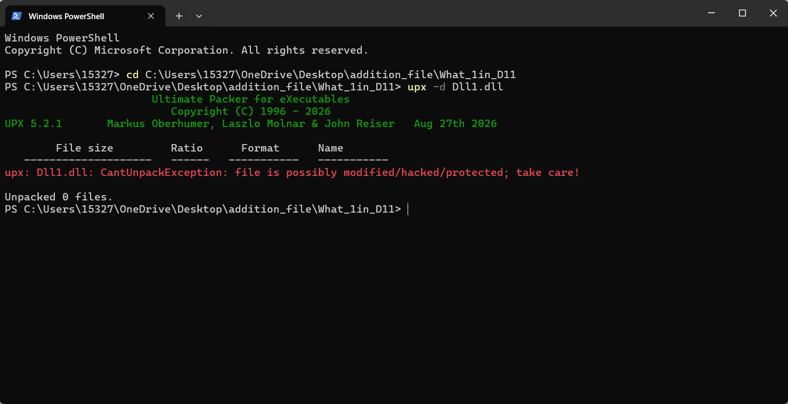
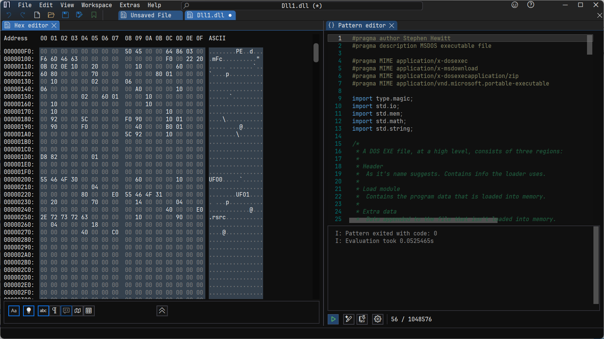
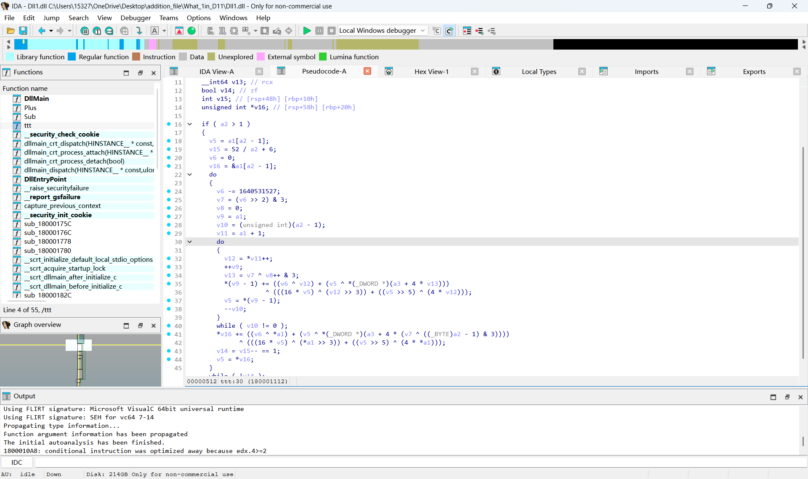

### 基础算法
BSAE64:使用64个字符来表示二进制数据  
编码过程主要是:原始二进制每三个字节(24位数据)是一组，把这24个数据分为4*6个段，每一段进行字符映射(对应一个BASE64字符)    
BASE64关键在于识别，平时见到**&0x3f**，**&0x3c**,**>>6**,**%64**等操作就能判断是BASE64了，解题并不需要写编码的语言，直接使用python第三方库    
一般而言，码表是**ABCDEFGHIJKLMNOPQRSTUVWXYZabcdefghijklmnopqrstuvwxyz0123456789+/**，不过有时候存在码表替换，需要在伪代码里自己找哪一个字节的值是新码表  
TEA摘自https://www.cnblogs.com/zpchcbd/p/15974293.html  
TEA：是一种分组加密算法  
以原文以**8字节**（64位bit）为一组，密钥**16字节**（128位bit）为一组，（char为1字节，int为4字节，double为8字节）主要运算为加法运算，位运算，异或运算  
首先从两边各自传入四个字节  
右边传入的4个字节，节称呼为M，M进行了三个部分的操作，M左移4位与密钥[0]相加，M右移5位与密钥[1]相加，M与δ相加，最后这三个算出的值再异或  
左边传入的4个字节，这里将这4个字节称呼为N，N=N+M  
同理再对N进行同样的操作，再令M=M+N
C代码：**其中v是待加密字段，k是密钥**
#include <stdio.h>  
#include <stdint.h>  
void encrypt (uint32_t* v, uint32_t* k) {  
uint32_t v0=v[0], v1=v[1], sum=0, i;          
    uint32_t delta=0x9e3779b9;                   
uint32_t k0=k[0], k1=k[1], k2=k[2], k3=k[3];     
    for (i=0; i < 32; i++) {                        
        sum += delta;  
        v0 += ((v1<<4) + k0) ^ (v1 + sum) ^ ((v1>>5) + k1);
        v1 += ((v0<<4) + k2) ^ (v0 + sum) ^ ((v0>>5) + k3);
    }                                              
    v[0]=v0; v[1]=v1;
}
void decrypt (uint32_t* v, uint32_t* k) {  
    uint32_t v0=v[0], v1=v[1], sum=0xC6EF3720, i;    
    uint32_t delta=0x9e3779b9;                       
    uint32_t k0=k[0], k1=k[1], k2=k[2], k3=k[3];     
    for (i=0; i<32; i++) {                           
        v1 -= ((v0<<4) + k2) ^ (v0 + sum) ^ ((v0>>5) + k3);  
        v0 -= ((v1<<4) + k0) ^ (v1 + sum) ^ ((v1>>5) + k1);  
        sum -= delta;
    }                                               
    v[0]=v0; v[1]=v1;  
}  
int main()  
{  
uint32_t v[2]={1,2},k[4]={2,2,3,4};  
printf("原始数据：%u %u\n",v[0],v[1]);  
    encrypt(v, k);  
    printf("加密后数据：%u %u\n",v[0],v[1]);  
    decrypt(v, k);  
    printf("解密后数据：%u %u\n",v[0],v[1]);  
    return 0;  
}  
XTEA:是TEA的加强版
XTEA使用了相同的加法运算，位运算，异或运算。但是触发顺序不同，这里指**四个子密钥的混合方式与原来不同**，所以运算的顺序也不同
C代码**其中v是待加密字段，k是密钥**  
#include <stdio.h>  
#include <stdint.h>  
void encipher(unsigned int num_rounds, uint32_t v[2], uint32_t const key[4]) {  
    unsigned int i;  
    uint32_t v0=v[0], v1=v[1], sum=0, delta=0x9E3779B9;  
    for (i=0; i < num_rounds; i++) {  
        v0 += (((v1 << 4) ^ (v1 >> 5)) + v1) ^ (sum + key[sum & 3]);  
        sum += delta;  
        v1 += (((v0 << 4) ^ (v0 >> 5)) + v0) ^ (sum + key[(sum>>11) & 3]);  
    }  
    v[0]=v0; v[1]=v1;  
}  
void decipher(unsigned int num_rounds, uint32_t v[2], uint32_t const key[4]) {  
    unsigned int i;  
    uint32_t v0=v[0], v1=v[1], delta=0x9E3779B9, sum=delta*num_rounds;  
    for (i=0; i < num_rounds; i++) {  
        v1 -= (((v0 << 4) ^ (v0 >> 5)) + v0) ^ (sum + key[(sum>>11) & 3]);  
        sum -= delta;  
        v0 -= (((v1 << 4) ^ (v1 >> 5)) + v1) ^ (sum + key[sum & 3]);  
    }  
    v[0]=v0; v[1]=v1;  
}  
int main()  
{  
    uint32_t v[2]={1,2};  
    uint32_t const k[4]={2,2,3,4};  
    unsigned int r=32;  
    printf("原始数据：%u %u\n",v[0],v[1]);  
    encipher(r, v, k);  
    printf("加密后数据：%u %u\n",v[0],v[1]);  
    decipher(r, v, k);  
    printf("解密后数据：%u %u\n",v[0],v[1]);  
    return 0;  
}  
仔细地观察两组代码，**发现for循环里对每一次取两位的待加密/解密字段的运算是不一样的，密钥下标取的也不一样**，这个得具体放到题目里去分析，后面写题解也会提及    
### 做题过程
还是先从基础的题目入手，积累一下经验  
#### [SWPUCTF 2022 新生赛]base64
先查壳发现没有壳，IDA打开发现没有花指令，可以直接反编译**mian**函数，发现一个函数**SUB_124C**打开它，根据前面笔记写的关键代码，判断是BASE64  

再发现关键字节off_4018，双击它，发现有两串字符串，一个乱码，一个好像就是**标准码表**这个乱码应该就是待解密的字符串  

直接对其进行base64解码，发现并不对，上网查发现base64是有**变种**的，尝试了base16,32,urlsafe，发现urlsafe才是对的
#### [GWCTF 2019]pyre
打开发现是一个.pyc文件，使用**pycdc**进行反编译，得到py源文件  

主要的操作是
for i in range(l):
    num = ((input1[i] + i) % 128 + 128) % 128  
    code += num  
for i in range(l - 1):  
    code[i] = code[i] ^ code[i + 1]  
解题时逆过来执行操作即可
首先按位置对密文进行异或，这里需要注意**下标**从len-2开始，第一次运算**正好是倒数第二位异或最后一位**，不然下标会超
for i in range(len(cipher) - 2, -1, -1):  
    cipher[i] = chr(ord(cipher[i]) ^ ord(cipher[i + 1]))  
然后再取密文的ord再减i，判断是不是在**ASCII的范围之内**(32-126)，不在再加128即可  
for i in range(len(cipher)):  
    temp = ord(cipher[i]) - i  
    if 32 < temp < 126:  
        cipher[i] = chr(temp)  
    else:  
        cipher[i] = chr(temp + 128)  
#### [MoeCTF 2022]ezTea
下载后发现一个main.c文件，打开发现是最基本的TEA函数，没有发现任何变种，根据dexrypt对应写decrypt，这里sum和delta我搞晕了很久  

解密: 
void decrypt (uint32_t* v, uint32_t* k) {     
	uint32_t delta = 0xd33b470;                      
    uint32_t v0 = v[0], v1 = v[1], sum=delta*32;  
    for (int i = 0; i < 32; i++) {  
        v1 -= ((v0<<4) + k[2]) ^ (v0 + sum) ^ ((v0>>5) + k[3]);  
        v0 -= ((v1<<4) + k[0]) ^ (v1 + sum) ^ ((v1>>5) + k[1]);  
        sum -= delta;  
    }  
    v[0] = v0;  
    v[1] = v1;  
}  
其中main函数里有一行uint32_t v[2] = {*(uint32_t *)&input[i], *(uint32_t *)&input[i+4]};    
大概意思是:字节数组里，**每4个字节拼成一个uint32_t**，**每8字节一组（v0,v1)**,所以如果想存储字节，密文的格式必须是uint8_t  
不过直接把密文写入main函数。最后打印的是hex(十六进制),还需要一番转化才能成chr字符串形式
#### [HNCTF 2022 WEEK3]What's 1n DLL?
解包后发现一个.exe一个.dll，前一个文件发现没有壳，直接IDA代开，发现v4,enc，**但是Dll1.dll,ttt两个疑似是处理的函数却打不开**  

查壳发现DL1.dll有upx壳，直接脱壳会报错，没办法，查了别人的题解发现使用**二进制编辑器打开**里面ASCII字段的值UPX被改为了UFO,改回UPX就可以了 

使用IDA打开后，发现有个**ttt**，和之前打开的ttt疑似是对应的，点击发现确实存在函数，仔细看好像是**XTEA**,不过似乎有很多变化的地方，我仅能看出a1是密文的疑似指针,v9和v11应该是待操作的密文,v6是疑似加密完sum的值  
其他的代码我都推不出来是如何和XTEA关联的，尝试无果后，没办法,又查了别人的题解脚本，不过我还没有彻底理解该脚本是如何实现对应的

