### 基础算法
#### RSA
RSA是一种非对称加密，使用**一对公钥和一对私钥**加密和解密，它涉及到一些数学知识  
如果p,q是两个不同的素数，n=p*q  
欧拉函数**φn=(p-1)(q-1)**，意义是小于n，且和n互质的整数的个数  
密钥的选取  
选两个素数p,q, 
n=p*q  
欧拉函数φn=(p-1)(q-1)  
选取公钥e **1<e<φn**，且gcd(e,φn)=1  
选取私钥d e.d===1(modφn)，即**d是e在模φn的模逆元**  
如果明文是m 
加密: **c=m的e次方mod n**  
解密: **m=c的d次方mod n**  
python代码  
import math  
def gcd(a,b):  
    while b:  
        a,b=b,a%b  
    return a  
def modinv(a,m):  
    g,x,y=extended_gcd(a,m)  
    if g!=1:  
        raise Exception('逆元不存在')  
    else:  
        return x%m  
def extended_gcd(a,b):  
    if b==0:  
        return (a,1,0)  
    else:  
        g,x1,y1=extended_gcd(b,a%b)  
        x = y1  
        y = x1-(a//b) * y1  
        return (g,x,y)  
def rsa_encrypt(m,e,n):  
    return pow(m,e,n)  
def rsa_decrypt(c,d,n):  
    return pow(c,d,n)  
p=11  
q=13  
n=p*q  
ola=(p-1)*(q-1)  
e=7  
d=modinv(e,ola)  
m=20  
c=rsa_encrypt(m,e,n)  
m2=rsa_decrypt(c,d,n)  
print(f"\n明文 m = {m}")  
print(f"加密后密文 c = {c}")  
print(f"解密还原 m' = {m2}")  
平时写代码时可以直接手搓函数直接使用，但是查阅资料发现，正规的写法应该是引用三方库随机生成随机密钥
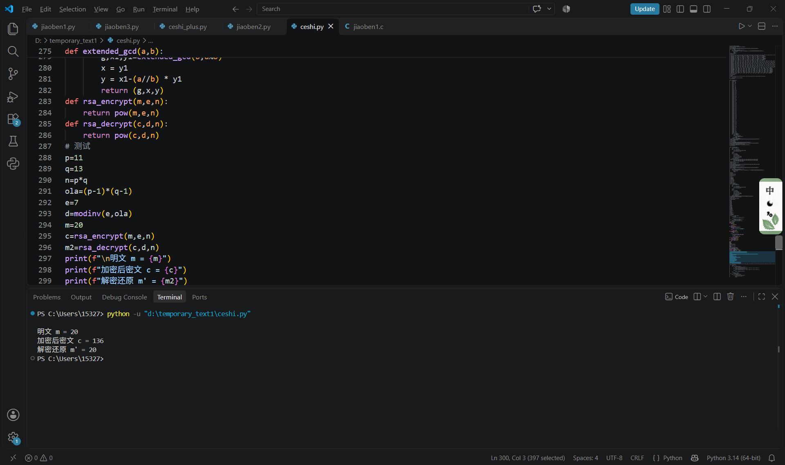
#### DFS,BFS
分别是两种不同的**遍历**方式，DFS是深度优先遍历:**访问当前节点后，依次遍历它所有相邻节点，如果发现没访问过就使用递归**，使用的结构是栈  
BFS是广度优先遍历:**起点入队，标记队首，出队后再遍历邻接点，如果没有访问就再入队，以此类推**,使用的结构是队列  
拿一道题目为例子分析二者代码区别  
[HNCTF 2022 WEEK4]ez_maze 解包，反编译后后得到源码，发现是一个迷宫，用wsad控制方向，只能走值为0的位置  
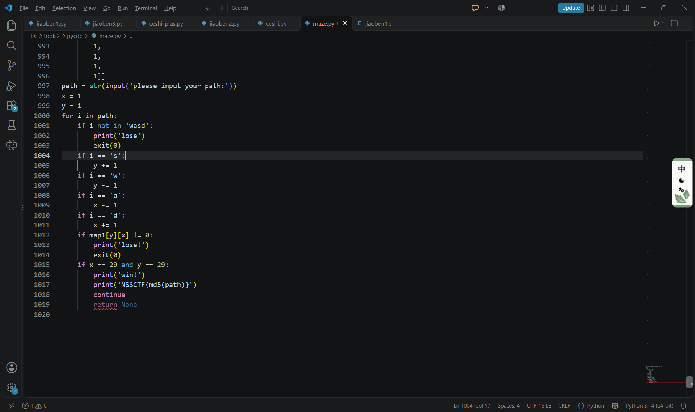
bfs代码,**dir是把wsad对应成二维数组里执行的动作,er,ec是确认终点的位置**  
**后面visit是记录每一步执行后的位置(nr,nc)，q是记录每一步的路径，注意函数返回值都是两个变量**  
from collections import deque  
def bfs(maze,start,end=None):  
    dirs=[(-1,0,'w'), (1,0,'s'), (0,-1,'a'), (0, 1,'d')]  
    sr,sc=start  
    rows=len(maze)  
    cols=len(maze[0])  
    if end==None:  
        er,ec=None,None  
        for c in range(cols):  
            if(maze[rows-2][c]==0):  
                er,ec=rows-2,c  
    else:  
        er,ec=end  
    if er==None:  
        return None,'无终点'  
    q=deque()  
    q.append((sr,sc,""))  
    visit=set()  
    visit.add((sr,sc))  
    while q:  
        r,c,path=q.popleft()  
        if r==er and c==ec:  
            return path,'路径'  
        for dr,dc,sym in dirs:  
            nr=dr+r  
            nc=dc+c  
            if 0<=nr<rows and 0<=nc<cols:  
                if (maze[nr][nc]==0 and (nr,nc) not in visit):  
                    visit.add((nr,nc))  
                    q.append((nr,nc,path+sym))  
    return None,'无通路'  
start_pt=(1,1)
ans,msg=bfs(map1,start_pt)
print(msg)  
if ans:  
    print(ans)  
因为迷宫比较小，此处dfs的代码其实和bfs很相似，最关键的**不同**在于**容器q的操作,BFS是popleft(队列)，DFS是pop(栈)**  
**BFS 得到最短路径，DFS 只得到一条通路**,只是这道题变化不多，两个算法**恰好输出的结果一样**
但是看别的题说DFS可能有**栈溢出**，只是这题没有遇到  
#### 贪心算法,动态规划
这里以**背包问题**举例子，因为我做题遇到的就是这个问题，后面还要就这个题对比两个算法  
假设存在不同的物品，每一个物品有不同的重量和不同价值，而且有一个重量的限制，研究的问题就是在不超过限制的前提下选择物品，使得价值取得最大值  
贪心算法就是**每一步都选当前局部最优的选项**  
动态规划是**计录每一个子问题的价值，再选择时参考记录进行遍历，遍历所有选择的组合之后，再选取最大值的组合**  
拿一道题目为例子分析二者代码区别  
[HNCTF 2022 WEEK3]Help_Me! IDA打开生成源码后，其实我一点思路也没有，尝试运行发现终端弹出了选择课程，尝试了多次发现超过**200**会猝死，这个200应该是一个限制

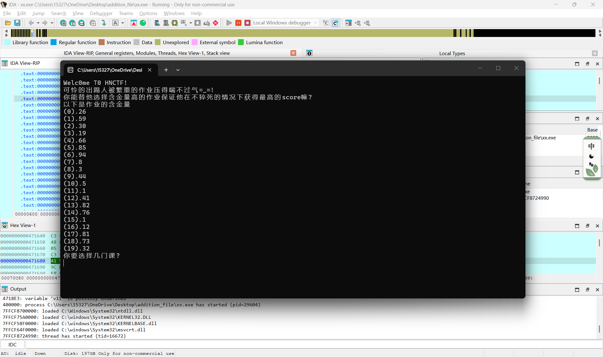
还是不会，后来参考了别的题解才发现原理是背包问题的贪心算法,动态规划，伪函数给的**初始两组数组**应该对应的就是**value,weight**  
贪心  发现贪心算法很直接，**item来记录每一个物品的性价比**,然后直接相加  
但是**局部最优并非全局最优**，这是使用贪心算法结果是**错误**的  
value = [26, 59, 30, 19, 66, 85, 94, 8, 3, 44, 5, 1, 41, 82, 76, 1, 12, 81, 73, 32]  
weight = [71, 34, 82, 23, 1, 88, 12, 57, 10, 68, 5, 33, 37, 69, 98, 24, 26, 83, 16, 26]  
capacity = 200  
items = []  
for i, (v, w) in enumerate(zip(value, weight)):  
    items.append({'ratio': v/w, 'value': v, 'weight': w, 'index': i})  
items.sort(key=lambda x: x['ratio'], reverse=True)  
score = 0  
tired = 0  
sub = []  
for item in items:  
    if tired + item['weight'] <= capacity:  
        score += item['value']  
        tired += item['weight']  
        sub.append(item['index'])  
print(f"Score: {score}, Tired: {tired}, Sub:{sub}")  
动态规划  **dp[i][j]是最大的价值 path是选择的组合**,1为存在，0为不存在  
后面ij两次循环是为了**遍历所有可能的组合，不断更新dp和path的状态**  
遍历完后再取最佳的选择组合  这里结果是**正确**的
value = [26, 59, 30, 19, 66, 85, 94, 8, 3, 44, 5, 1, 41, 82, 76, 1, 12, 81, 73, 32]  
weight = [71, 34, 82, 23, 1, 88, 12, 57, 10, 68, 5, 33, 37, 69, 98, 24, 26, 83, 16, 26]  
cap = 200  
n = len(value)  
dp = [[0]*(cap+1) for _ in range(n+1)]  
path = [[0]*(cap+1) for _ in range(n+1)]  
for i in range(1, n+1):  
    v = value[i-1]  
    w = weight[i-1]  
    for j in range(1, cap+1):  
        if j >= w and dp[i-1][j - w] + v > dp[i-1][j]:  
            dp[i][j] = dp[i-1][j - w] + v  
            path[i][j] = 1  
        else:  
            dp[i][j] = dp[i-1][j]  
            path[i][j] = 0  
res = []  
j = cap  
for i in range(n, 0, -1):  
    if path[i][j] == 1:  
        res.append(i-1)  
        j -= weight[i-1]  
res.reverse()  
print(f"总价值：{dp[n][cap]}, 总重量：{sum(weight[x] for x in res)}")
print(f"下标：{res}")
### 动态调试
动态调试是使得程序**创建进程，加载内存，创建CPU运行指令**，IDA可以查看寄存器的值，查看内存里的数据等  
而静态查汇编语言，F5反编译都是对程序的处理，并不直接运行程序  
更为重要的是，其可以通过**单步走，暂停，修改寄存器/内存器等直接控制**程序的执行过程  
而"下断点"的意思是给CPU设置一个**到这里停下**的标记，此时在运行时CPU执行到这条指令时就会停下，我们就可以进行**控制/修改**操作  
还是以一道基础题为例子
#### [Reisen]NSSCTF2025入门题目-Debug  
查壳为没有壳,IDA打开后发现有一条汇编语言让你**按F2**下断点，先把主函数生成伪代码，发现伪代码里还有相同的**注释**  
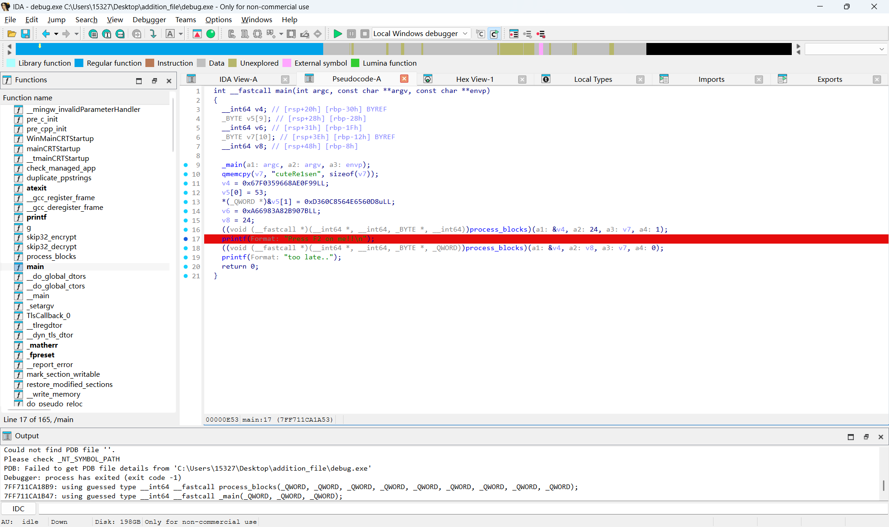
把printf这条语句下断点，开启调试后，会发现进入了调试界面 按理说pressblocks函数只对a1执行了与操作，程序运行完这个函数后，应该查找的值是a1，但是在**Debug view**界面并没有查到  
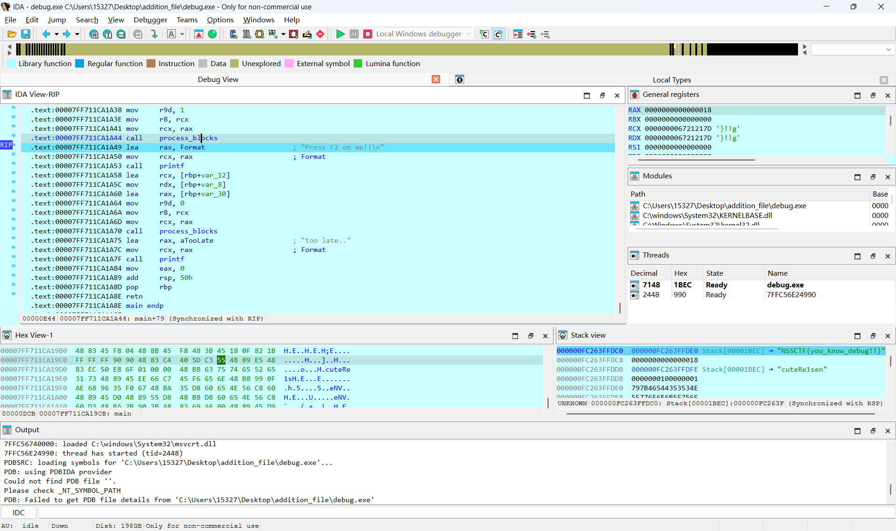
后来把中间几步汇编语言查了一下才发现，程序已经把a1的值写入了寄存器里，在右上角寄存器查找a1的值，还真找到了flag的标签  
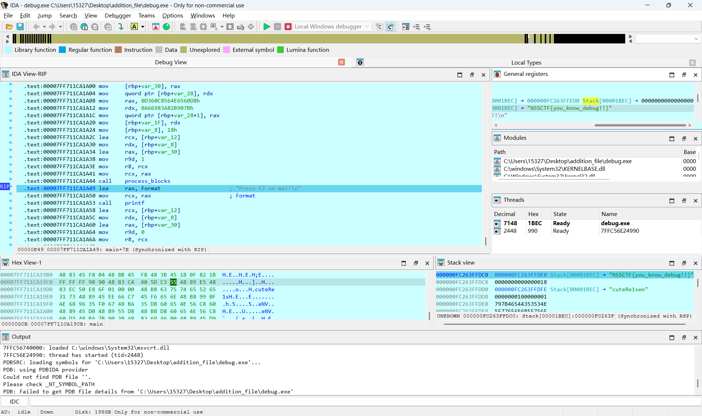
后面尝试做题发现有很多题目的文件是linux操作系统而不是win，这种文件不能再windows里动态调试，右上角的运行按钮都是灰色的
### 做题过程
#### [LitCTF 2023]程序和人有一个能跑就行了
查壳，IDA打开，直接main函数反编译后，发现buf1还有一堆别的函数，在sub_4015A0函数发现循环密钥生成，而且周期为256，我想到rc4算法，主函数里的litctf应该就是kwy了  
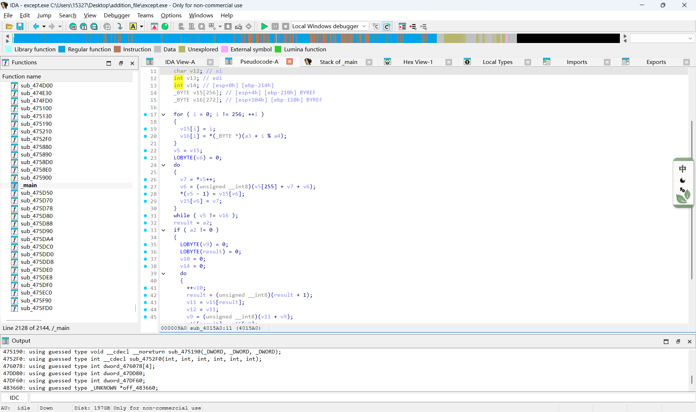
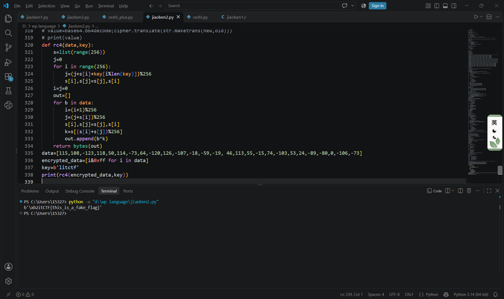
直接尝试，发现输出的是fake_flag，重新看main函数似乎也没有找到问题  重新在汇编窗口看汇编语言发现了问题
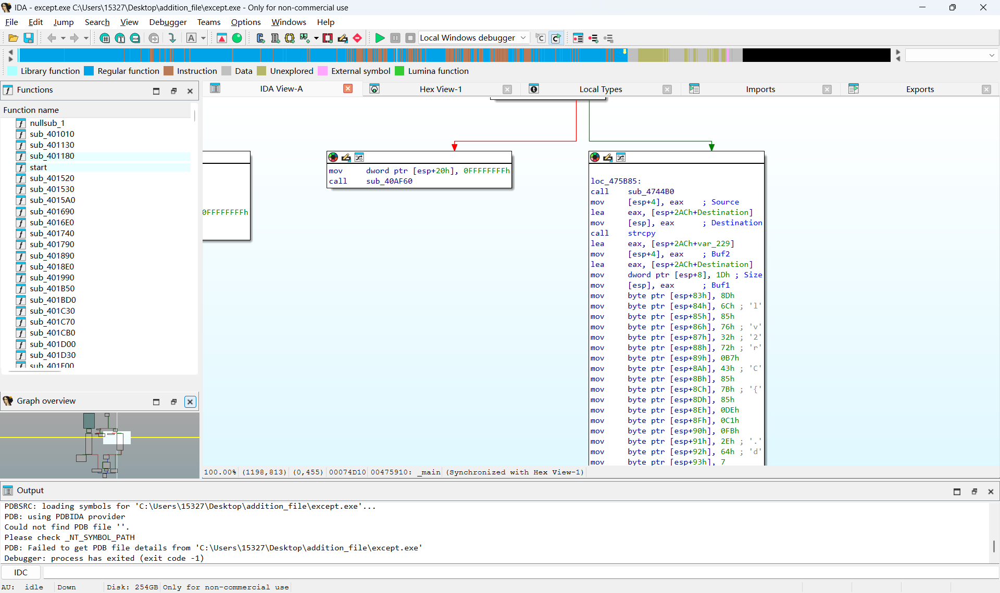
**buf1数组的窗口有lea eax, [esp+2ACh+Buf2],lea  eax, [esp+2ACh+Buf1]两条语句，buf2应该也写入eax了，但是主函数只有buf1，在汇编窗口找了半天，发现右侧居然有buf2的数组**  
**把buf1的数据替换为buf2再试试，发现对了**  
def rc4(data,key):  
    s=list(range(256))  
    j=0  
    for i in range(256):  
        j=(j+s[i]+key[i%len(key)])%256  
        s[i],s[j]=s[j],s[i]  
    i=j=0  
    out=[]  
    for b in data:  
        i=(i+1)%256  
        j=(j+s[i])%256  
        s[i],s[j]=s[j],s[i]  
        k=s[(s[i]+s[j])%256]  
        out.append(b^k)  
    return bytes(out)  
ciphertext = [0x8D, 0x6C, 0x85, 0x76, 0x32, 0x72, 0xB7, 0x43, 0x85, 0x7B, 0x85, 0xDE, 0xC1, 0xFB, 0x2E, 0x64, 0x07,
              0xC8, 0x5F, 0x9A, 0x35, 0x18, 0xAD, 0xB5, 0x15, 0x92, 0xBE, 0x1B]  
key=b'litctf'  
print(rc4(ciphertext ,key))   
在此之前我也试过动态调试，但是卡住了，debug窗口主函数汇编窗口一直没有
#### [GDOUCTF 2023]Tea
IDA打开后试着从mian伪代码里的一大堆函数去寻找密钥，密文和加密方式  找到密文v8，密钥a1,观察加密函数发现和标准的xtea不一样
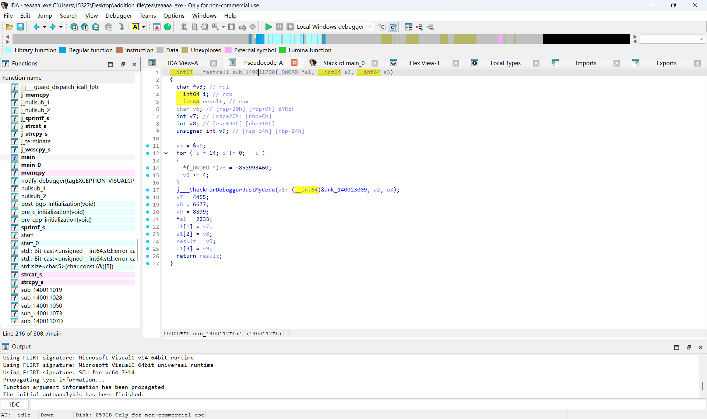
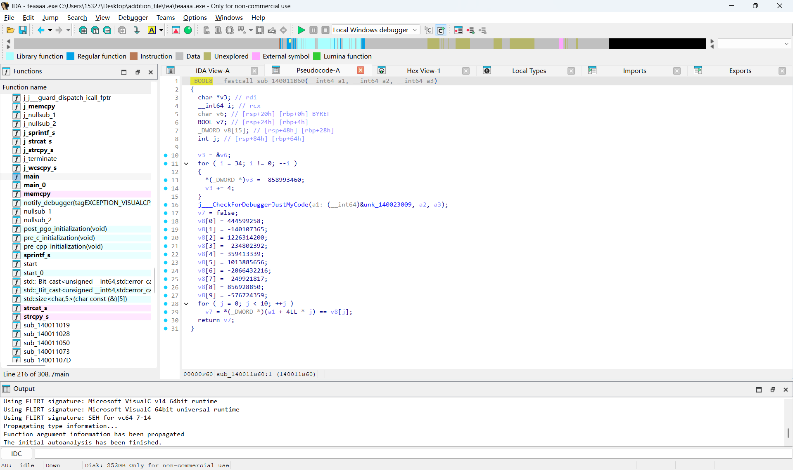
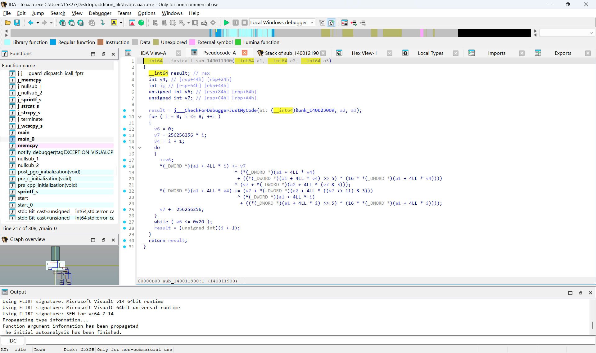
**外层循环8次，内层32次，因为0x20=32，条件又是while ( v6 <= 0x20 )**  
现在最关键的一步就是根据加密函数逆向写解密函数过程，需要注意**内层加和异或的顺序**，这里我花了不少时间才写好
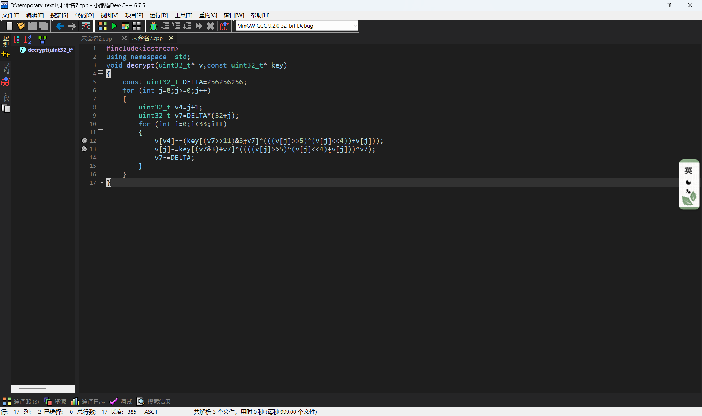
接下来就是写主函数了，把密文和密钥代入到函数求解  
#include<iostream>  
using namespace std;  
void decrypt(uint32_t* v,const uint32_t* key)  
{  
	const uint32_t DELTA=256256256;  
	for (int j=8;j>=0;j++)  
	{  
		uint32_t v4=j+1;  
		uint32_t v7=DELTA*(32+j);  
		for (int i=0;i<33;i++)  
		{  
			v[v4]-=((key[(v7>>11)&3]+v7)^(((v[j]<<4)^(v[j]>>5))+v[j]));  
			v[j]-=(((key[(v7&3)])+v7)^((((v[j]<<4)^(v[j]>>5))+v[v4]))^v7);  
			v7-=DELTA;  
		}  
	}  
}  
int main()  
{  
	uint32_t key[4]={2233,4455,6677,8899};  
    uint32_t v8[10];  
	v8[0] = 444599258;  
	v8[1] = -140107365;  
	v8[2] = 1226314200;  
	v8[3] = -234802392;  
	v8[4] = 359413339;  
	v8[5] = 1013885656;  
	v8[6] = -2066432216;  
	v8[7] = -249921817;  
	v8[8] = 856928850;  
	v8[9] = -576724359;  
	decrypt(v8,key);  
	for(int i=0;i<10;i++)  
	{  
		for(int j=3;j>=0;j--)  
		{  
			putchar((v8[i]>>(8*j)));  
		}  
	}  
	return 0;  
}
#### [CISCN 2022 东北]easycpp
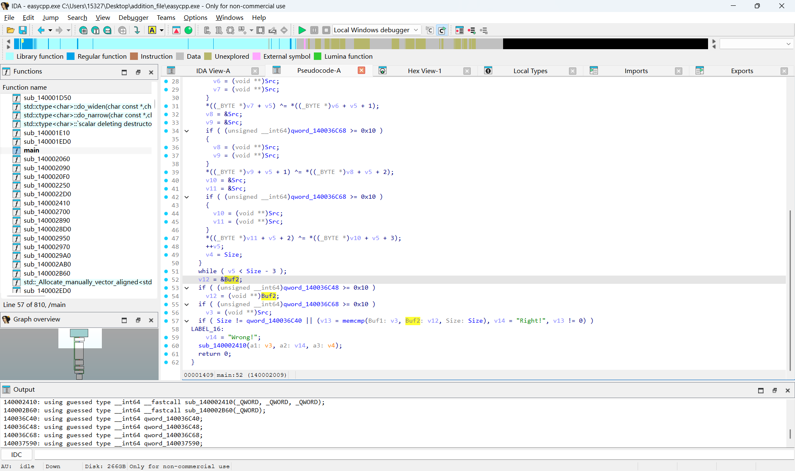
IDA打开后，发现最后memcmp复制一个buf1一个buf2，前面buf2还和v12进行了异或操作，先尝试**动态调试获取buf2的值**   
在buf2的**地址**位置下断点(先尝试的在伪代码异或处下断点发现不行)，启动后会提示你该位置有断点，在调试窗口发现**程序停在了mov rax,rbx这里**，有可能是把buf2写入了寄存器  
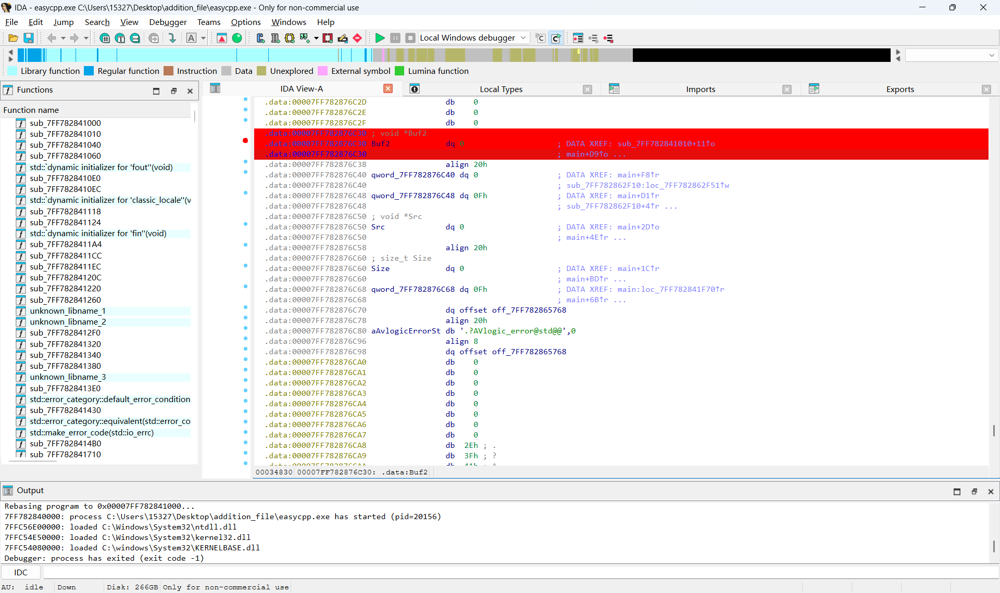
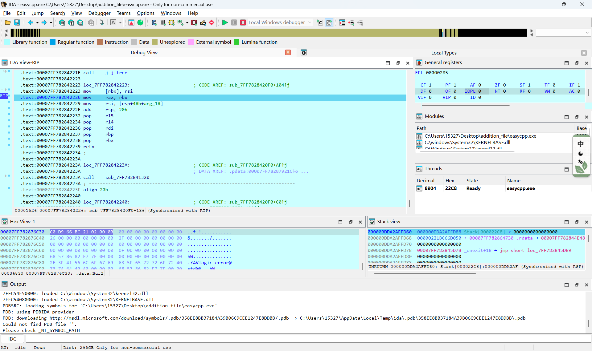
**点击rax进入寄存器**，还真有数组，一共有38位，shift E提取数组，但是不知道是如何处理该数组的
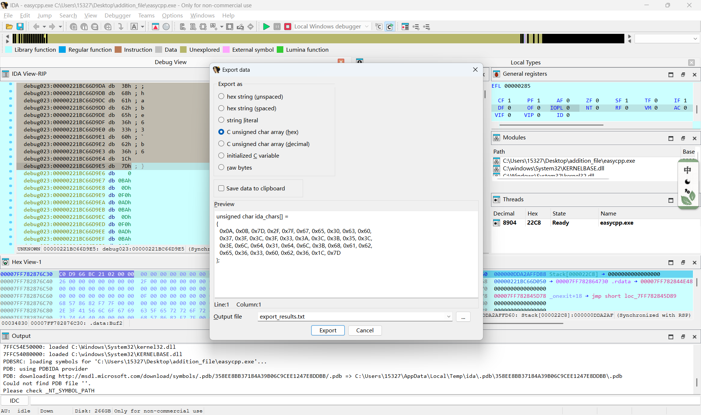
重新读伪代码前面的语句，好像真正执行的只有三句 *((_BYTE *)v7 + v5) ^= *((_BYTE *)v6 + v5 + 1)  
*((_BYTE *)v9 + v5 + 1) ^= *((_BYTE *)v8 + v5 + 2)  
*((_BYTE *)v11 + v5 + 2) ^= *((_BYTE *)v10 + v5 + 3) 借鉴别人的题解后发现我思考的是对的，**这是src每一个位置与下一个位置异或，得到的值取代原来的值**  
求解是按照顺序反过来就好了，需要注意把十六进制转为十进制数  
cipher = "0A0B7D2F7F6765306360373F3C3F333A3C3B353C3E6C6431646C3B6861626536336062361C7D"  
flag = []  
for i in range(0,len(cipher),2):  
    flag.append(int(cipher[i:i+2],16))  
for i in range(len(flag)-4,-1,-1):  
    flag[i+2] ^= flag[i+3]  
    flag[i+1] ^= flag[i+2]  
    flag[i] ^= flag[i+1]  
for i in range(len(flag)):  
    print(chr(flag[i]),end="")  
#### [MTCTF 2021]Random
IDA打开后发现有rand随机数，**rand生成随机数赋予v4，这个v5在和rand生成的随机数异或**，再和v8进行逐字节异或 byte_843370[v9] != byte_842138[v8]
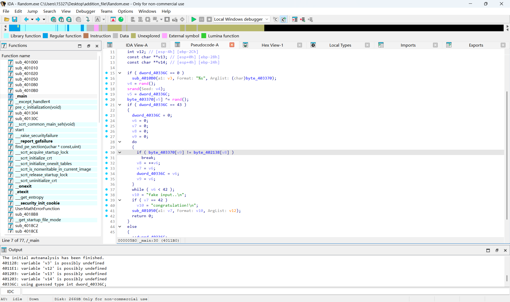
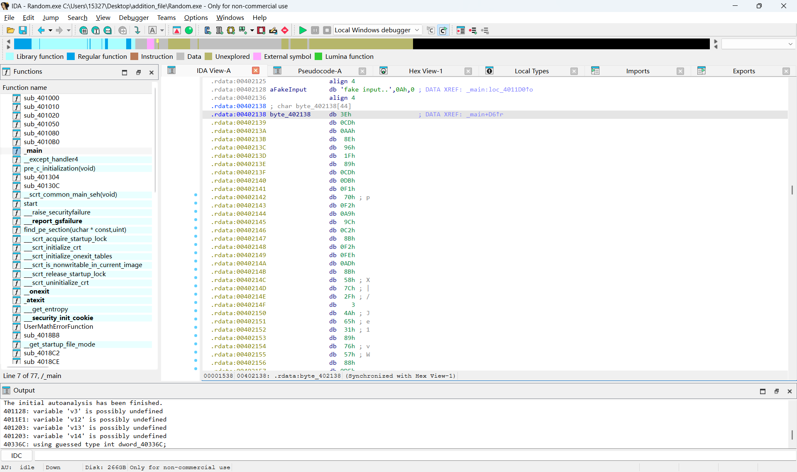
v8能直接得到，但v5不行，因为不知道**每一次rand生成的随机数是什么**，这好像不得不动态调试了  
这里我尝试了很久，但都没成功，参考题解说**必须两个位置同时下断点:v4 = rand()，byte_843370[v5] ^= rand()** (这两个位置我都下过，但只是单独下)
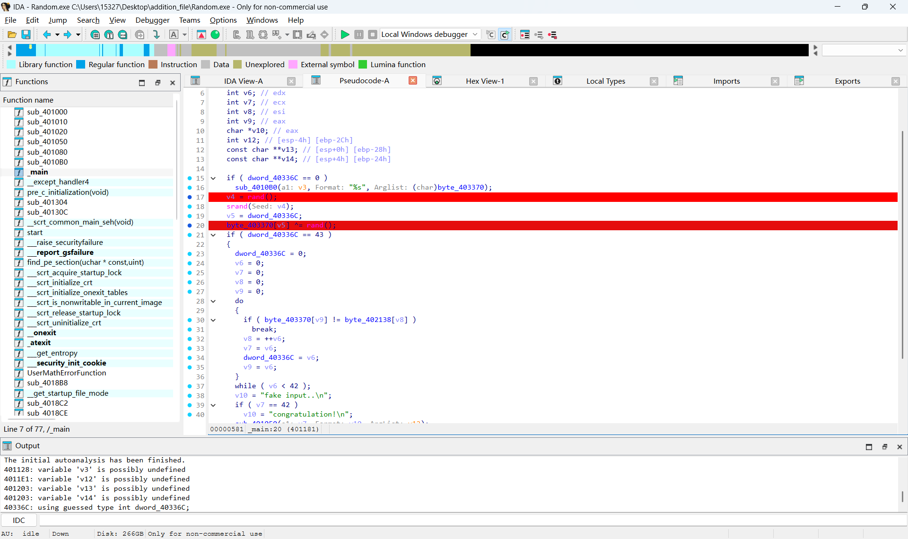
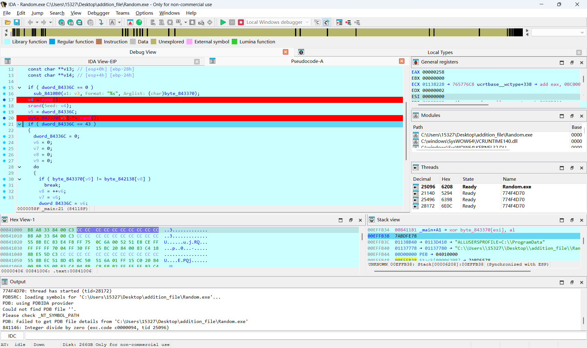
后来查资料才发现C标准库rand有**全局种子**，**每调用一次 rand,内部状态就变一次** 
下断点后运行，发现循环起来了,观察右上角，**每次存进寄存器EAX的值都不同，取每次寄存器的后两位即为十六字节的值(这也是其他题解写的)**，就这样一步一步运行程序，得到v5所有十六进制的值
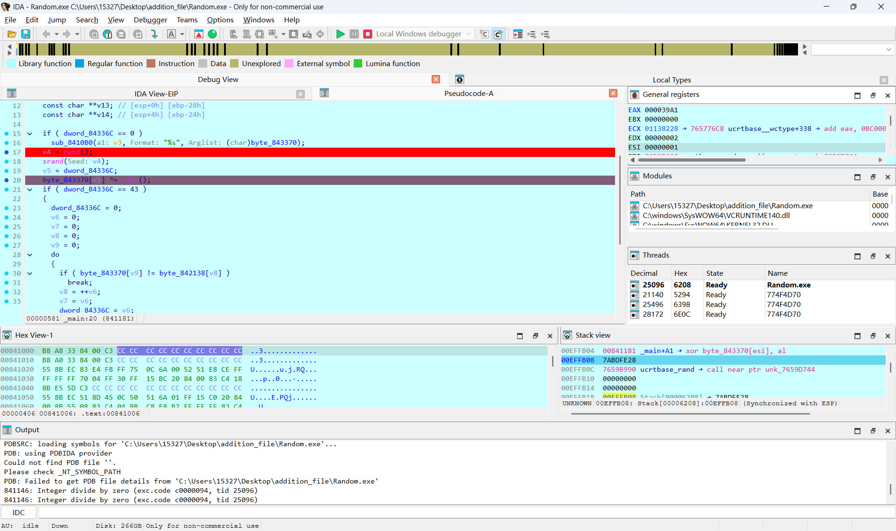
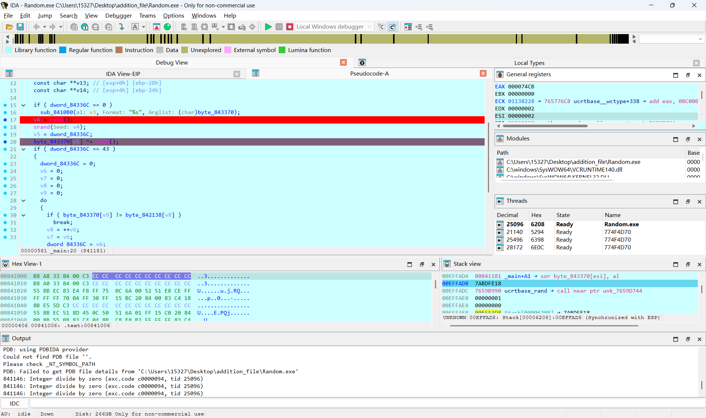
最后v5与v8进行逐字节异或即可  
random = [0x58,0xa1,0xCB,0xE9,0xED,0x2C,0xEC,0xFB,0xE9,0xC4,0x16,0x97,0x99,0xb1,0xa4,0xe9,0xc3,  
          0xc6,0x80,0xBF,0x3e,0x44,0x18,0x2e,0x73,0x56,0x52,0xB8,0x5B,0x66,0xED,0xBC,0x8a,0xd8,  
          0x36,0x8f,0xe6,0xd3,0xb1,0x51,0xb9,0x59,0xd3,0x5a]  
key=[0x3E, 0xCD, 0xAA, 0x8E, 0x96, 0x1F, 0x89, 0xCD, 0xDB, 0xF1, 0x70, 0xF2, 0xA9, 0x9C, 0xC2,  
0x8B, 0xF2, 0xFE, 0xAD, 0x8B, 0x58, 0x7C, 0x2F, 0x03, 0x4A, 0x65, 0x31, 0x89, 0x76, 0x57, 0x88,  
0xDF, 0xB8, 0xE9, 0x01, 0xE9, 0xDE, 0xE5, 0x86, 0x68, 0x8F, 0x24, 0xD3, 0x5A]  
flag = ""  
for i in range(len(key)):  
    flag += chr(key[i] ^ random[i])  
print(flag)
#### [suctf 2019]signin
IDA打开之后发现有一个函数重复出现__gmpz_init_set_str，点击它又什么都没有，观察**a2有一长串字符疑似是密文，还有65537疑似是密钥**
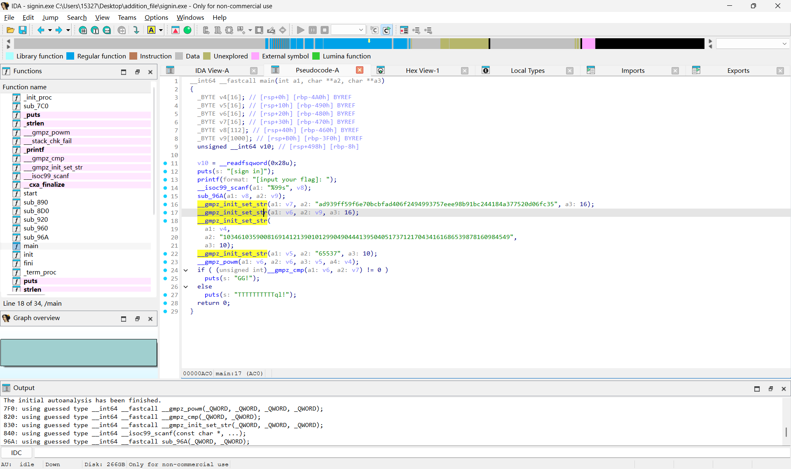
上网查这个函数才发现它和RSA相关，它是一个算法库，**03461035900816914121390101299049044413950405173712170434161686539878160984549应该就是这个函数的操作对象**
好像需要**import gmpy2用这个库**，这对我有点复杂了，我找了一个网站来求得pq的值，有**p,q,e=65537，密文，就可以开始解密了**直接尝试用自己写的RSA，发现正确，不需要引用库了  
解密后数据类型是ord，直接与0xff异或后再chr发现错误,使用**binascii.unhexlify**函数来进行数据转换，注意需要补齐0  
import math  
def gcd(a,b):  
    while b:  
        a,b=b,a%b  
    return a  
def modinv(a,m):  
    g,x,y=extended_gcd(a,m)  
    if g!=1:  
        raise Exception('逆元不存在')  
    else:  
        return x%m  
def extended_gcd(a,b):  
    if b==0:  
        return (a,1,0)  
    else:  
        g,x1,y1=extended_gcd(b,a%b)  
        x = y1  
        y = x1-(a//b) * y1  
        return (g,x,y)  
def rsa_encrypt(m,e,n):  
    return pow(m,e,n)  
def rsa_decrypt(c,d,n):  
    return pow(c,d,n)  
p=282164587459512124844245113950593348271  
q=366669102002966856876605669837014229419  
n=p*q  
c=0xad939ff59f6e70bcbfad406f2494993757eee98b91bc244184a377520d06fc35  
ola=(p-1)*(q-1)  
e=65537  
d=modinv(e,ola)  
value2=rsa_decrypt(c,d,n)  
print(value2)  
import binascii  
h=hex(value2)[2:]  
if len(h)%2!=0:  
    h='0'+h  
data=binascii.unhexlify(h)  
print(data.decode('ascii'))  
