### C语言
在学习和做题过程中发现自己C语言很多地方尚未搞懂，重新回顾一下  
#### 数据类型
char：**字符**  
short int:**小整数**  
int：**普通整数**  
long int：**大整数**  
float：**单精度小数**  
double:**双精度小数**  
unsigned int **非负整数**  
在之前写tea算法的时候经常会遇见uint32_t的数据类型，这里终点记录一下  
uint32_t:**固定32位无符号整数，4字节，范围是0 ~ 0xFFFFFFFF**
使用必须声明,**#include <stdint.h>**
因为把有符号/64 位的值赋给uint32_t时按2³²取模，所以**用&0xFFFFFFFF是为了显式截取低32位**
因为TEA算法执行的所有移位，模加法，模减法，异或操作，必须保证操作对象是**固定32bit**  
和它类似的数据类型有  
uint8_t ：**8位无符号，1 字节，0~255**  
uint16_t：**16位无符号，2 字节，0~65535**  
uint64_t：**64位无符号，8 字节**  
#### 常用函数，运算符，指针
cout:是一种标准的输入输出流，表示**打印输出对象到控制台**，使用该语句必须声明，**#include<iostream>**，还要声明**using namespace std;**  
cout最后使用<< end1表示换行
cout << 内容是输出，对应的cin >> 变量是输入  
strlen:**求字符串的长度，包括换行符。**  
strcpy:**字符串的复制，也包括换行符。**，strcpy(a, b)表示把b拷贝到a，并且a被覆盖  
strcmp:**字符串的比较, strcmp(a, b)**，表示逐字符比a,b的ASCII的值，返回整数a>b，返回负数a<b，返回零a=b  
strcat:**字符串的追加**，strcat(a,b)把b追加到a后面  
这四个函数想使用，必须声明,**#include <string.h>**  
举一个简单地例子  
#include <iostream>  
#include <string.h>  
using namespace std;  
int main()  
{  
    char a[50] = "hello";  
    char b[] = "nihao";  
    cout << "a长度：" << strlen(a) << endl;  
    strcat(a, b);
    cout << "拼接 a：" << a << endl;  
    char c[50];  
    strcpy(c, a);  
    cout << "拷贝 c：" << c << endl;  
    if(strcmp(a, c) == 0)  
    {  
        cout << "a 和 c 相等" << endl;  
    }  
    return 0;  
}  
输出 a长度：5  
拼接 a：hellonihao  
拷贝 c：hellonihao  
a 和 c 相等  
getchar():从标准输入读取字符  
putchar():想控制台输入字符  
这两个函数想用，必须声明,**#include <stdio.h>**  
位运算符:是在**二进制**层面进行的运算  
<<：**左移**,>>: **右移**  
这里的左右移的操作对象都是**数据的二进制表示**，而不是本来的数据  
&:**按位与，都是1才为1**  
|:**按位或，有1就是1**  
^:**按位异或，不同为1**  
~:**按位取反，01互换**  
举一个简单的例子  
#include <iostream>  
using namespace std;  
int main()  
{  
    int a = 6;  
    int b = 3;  
    cout << "a & b = " << (a & b) << endl;  
    cout << "a | b = " << (a | b) << endl;  
    cout << "a ^ b = " << (a ^ b) << endl;  
    cout << "a << 1 = " << (a << 1) << endl;  
    cout << "a >> 1 = " << (a >> 1) << endl;  
    cout << "~a = " << (~a) << endl;  
    return 0;  
}  
输出:a & b = 2  
a | b = 7  
a ^ b = 5  
a << 1 = 12  
a >> 1 = 3  
~a = -7  
指针:**用于存放内存地址**
&**用于取变量在内存中的地址**
(**)**在定义的时候表示指针变量，在使用的时候表示解引用，表示读取该地址上存放的值**  
举一个简单的例子  
int a=1;  
int *p=&a;  
*p=100;  
printf("%d",a);输出的a就是100而不是1  
再举tea的例子  
void encrypt(uint32_t* v, uint32_t* k) {  
    uint32_t v0 = v[0], v1 = v[1], sum = 0, i;  
    uint32_t delta = 0x114514;  
    for (i = 0; i < 32; i++) {  
        sum += delta;  
        v0 += ((v1 << 4) + k[0]) ^ (v1 + sum) ^ ((v1 >> 5) + k[1]);  
        v1 += ((v0 << 4) + k[2]) ^ (v0 + sum) ^ ((v0 >> 5) + k[3]);  
    }  
    v[0] = v0; v[1] = v1;  
}  
void decrypt(uint32_t* v, uint32_t* k){  
    uint32_t v0 = v[0], v1 = v[1];  
    uint32_t delta = 0x114514;  
    uint32_t sum = delta * 32;  
    for (int i = 0; i < 32; i++) {  
        v1 -= ((v0 << 4) + k[2]) ^ (v0 + sum) ^ ((v0 >> 5) + k[3]);  
        v0 -= ((v1 << 4) + k[0]) ^ (v1 + sum) ^ ((v1 >> 5) + k[1]);  
        sum -= delta;  
    }  
    v[0] = v0; v[1] = v1;  
}  
**形参声明为指针类型。调用的是数组传参，而数组传参本质上就是传指针。**
**指针本身是可以运算的**，**所以v[0]、v[1] 等于 *(v+0)、*(v+1)成立**。指针的加减伴随着指针本身字节的变化
而void类型指针又不一样
void *p表示一种通用的指针p，它可以存放任意数据类型的地址，但是不能解引用，也不能参与指针的运算
#### 算法
RC4作为对称加密，语句基本和python差不多，关键是注意数据类型
#include <stdio.h>  
#include <string.h>  
typedef unsigned char u8;  
void rc4_init(u8 *S, const u8 *key, int keylen)  
{  
    int i, j = 0;  
    u8 tmp;  
    for (i = 0; i < 256; i++) S[i] = i;  
    for (i = 0; i < 256; i++) {  
        j = (j + S[i] + key[i % keylen]) % 256;  
        tmp = S[i]; S[i] = S[j]; S[j] = tmp;  
    }  
}  
void rc4_crypt(u8 *S, u8 *data, int len)  
{  
    int i = 0, j = 0, t;  
    u8 tmp;  
    for (int k = 0; k < len; k++) {  
        i = (i + 1) % 256;  
        j = (j + S[i]) % 256;  
        tmp = S[i]; S[i] = S[j]; S[j] = tmp;  
        t = (S[i] + S[j]) % 256;  
        data[k] ^= S[t];  
    }  
}  
int main()  
{  
    u8 S[256];  
    u8 key[] = "rc4key";  
    u8 data[] = "hello rc4";  
    int len = strlen((char*)data);  
    printf("%s\n", data);  
    rc4_init(S, key, strlen((char*)key));  
    rc4_crypt(S, data, len);  
    for(int i=0;i<len;i++) printf("%02x ", data[i]);  
    printf("\n");  
    rc4_init(S, key, strlen((char*)key));  
    rc4_crypt(S, data, len);  
    printf("%s\n", data);  
    return 0;  
}
RSA本身的写法和python不太一样,使用C语言必须提前安装GMP库，使用这个库的相关语句执行加解密
#include <stdio.h>  
#include <gmp.h>  
void rsa_encrypt(mpz_t c, mpz_t m, mpz_t e, mpz_t n)  
{  
    mpz_powm(c, m, e, n);  
}  
void rsa_decrypt(mpz_t m, mpz_t c, mpz_t d, mpz_t n)  
{  
    mpz_powm(m, c, d, n);  
}  
int main()  
{  
    mpz_t p, q, n, phi, e, d, m, c, res;  
    mpz_inits(p,q,n,phi,e,d,m,c,res,NULL);  
    mpz_set_str(p, "61", 10);  
    mpz_set_str(q, "53", 10);  
    mpz_mul(n, p, q);  
    mpz_sub_ui(p,p,1);  
    mpz_sub_ui(q,q,1);  
    mpz_mul(phi, p, q);  
    mpz_set_ui(e, 17);  
    mpz_invert(d, e, phi);  
    printf("n = "); mpz_out_str(stdout,10,n); putchar('\n');  
    printf("e = "); mpz_out_str(stdout,10,e); putchar('\n');  
    printf("d = "); mpz_out_str(stdout,10,d); putchar('\n');  
    mpz_set_ui(m, 65);   
    rsa_encrypt(c, m, e, n);  
    printf("cipher = "); mpz_out_str(stdout,10,c); putchar('\n');  
    rsa_decrypt(res, c, d, n);  
    printf("plain = "); mpz_out_str(stdout,10,res); putchar('\n');  
    mpz_clears(p,q,n,phi,e,d,m,c,res,NULL);  
    return 0;  
}
### 做题记录
#### [GDOUCTF 2023]润！
查壳发现是有壳的，还让你尝试upx，直接尝试发现失败，于是想到核查壳的标志。使用**Imhex**工具查看标志字段被改了，**改回UPX字段**，再脱壳发现成功了。
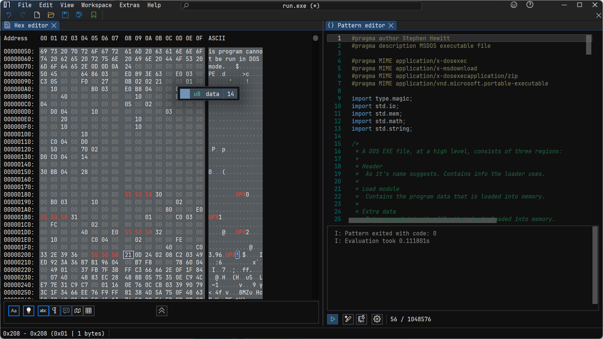
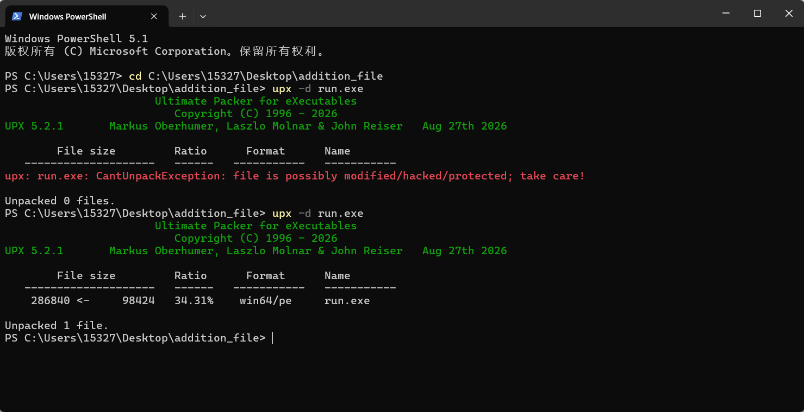
查看代码的init函数发现生成了一个**puzzle**的数组，但是点击它并没有值，可以使用**动态调试**得到值    
在moving函数里发现**wsad控制，除此之外还有un控制**。目前不清楚un是什么，但能确定是个迷宫类问题
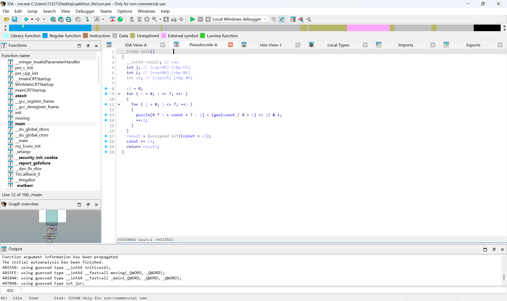
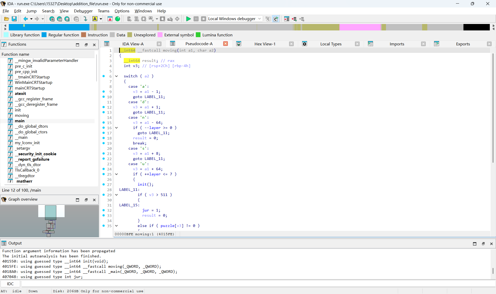
使用动态调试先获取puzzle数组，这里不需要步步调，把puzzle的**地址**记住就好，在init函数后面随便下一个断点，在**调试页面按G进行搜索**(**先复制puzzle的地址**)发现puzzle已经运行出来了。
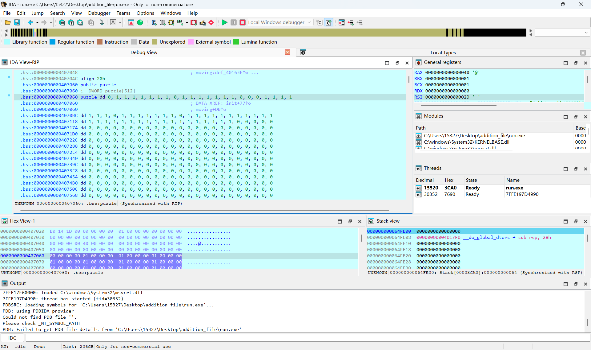
这个迷宫本身不对劲，查了别的题解才发现这个迷宫是**8*8*8三维的**，不是以前遇到的二维的。前面**un每步是+-64而不是1或8**，疑似是分别控制层数上下。  
现在需要把puzzle的进行整理输出，puzzle后面的gen有好多255,253之类的数据，但我不知道如何利用这些数据**输出每一层的二维数组**，借鉴脚本输出每一层的二维数组  
gen = [127, 127, 31, 223, 223, 255, 255, 255, 255, 255,  
       241, 255, 223, 255, 255, 255, 255, 255, 197, 223,  
       223, 255, 255, 255, 255, 255, 253, 255, 255, 255,  
       255, 255, 255, 253, 253, 253, 252, 255, 255, 255,  
       255, 255, 255, 255, 254, 254, 252, 249, 255, 255,  
       255, 255, 255, 255, 255, 251, 255, 255, 255, 255,  
       255, 255, 255, 248]  
count = 0  
map = [0]*512  
for k in range(8):  
    for i in range(8):  
        for j in range(8):  
            map[8 * i + conut + 7 - j] = (gen[int(conut / 8) + i] >> j) & 1  
    count += 64  
    for i in range(0+k*64,64+k*64,8):  
        print(map[i:i+8])  
    print('*'*50)
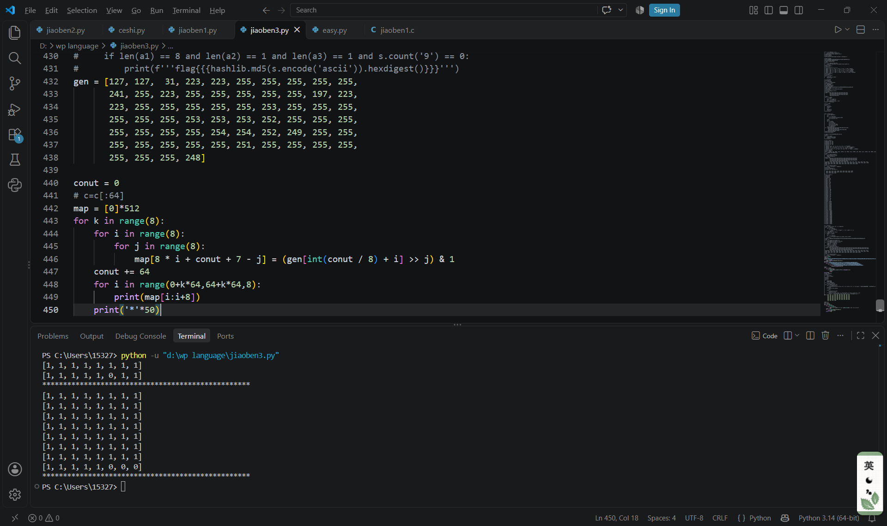
仔细想这个脚本好像也没那么难理解。输出数组后直接**手动走一遍三维迷宫，得到路径ssddssuuwwddndduuussdussasauudd**。这个手动的过程还是比较绕的
#### [SWPUCTF 2024 秋季新生赛]动态调试
IDA打开后发现有个函数是**rc4_init**，可以判定考的函数是Rc4,后面**rc4_crypt**函数点进去看，发现和标准是一样的，key点击也能查看到，关键是不知道密文是什么 
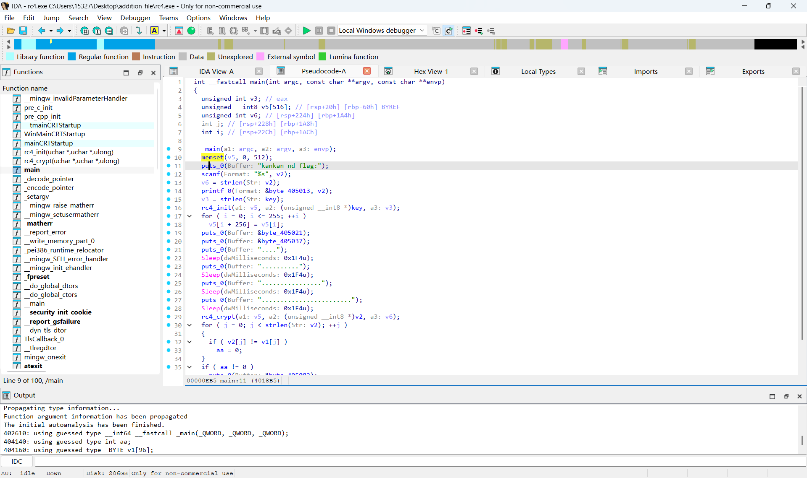
最后的判断条件是**v2[j] != v1[j]**，前面的函数表明v2是用户输入的，Rc4的对象也是v2，**能做密文的只能是v1**，但是Rc4操作对象不是v1  
使用动态调试，在**rc4_crypt**下断点，尝试把v2的值修改为v1，运行后停在mov机器码处。发现**rdx, v2**这个机器码，**rdx寄存器应该存的就是v2的地址**  
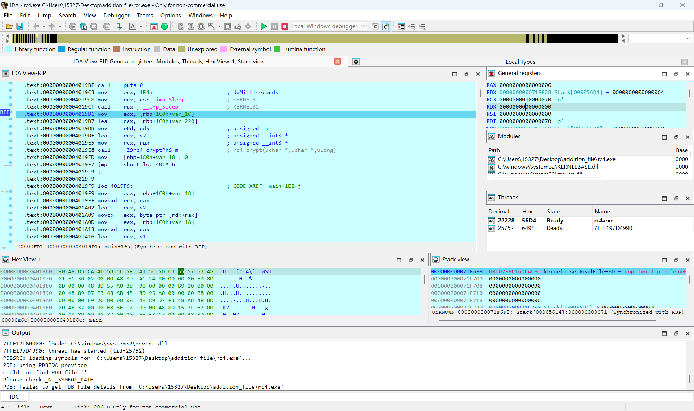
之前先复制v1的地址，**把rdx的地址改成v1的**，再步步调试执行rc4_crypt，但是发现一直不对  
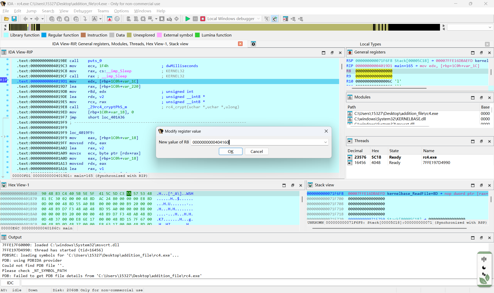
查了别人的题解，发现漏了一个关键信息是**r8d**，**该寄存器是存储密文的长度，而v1，v2长度并不一致，所以在修改时也必须修改长度**  
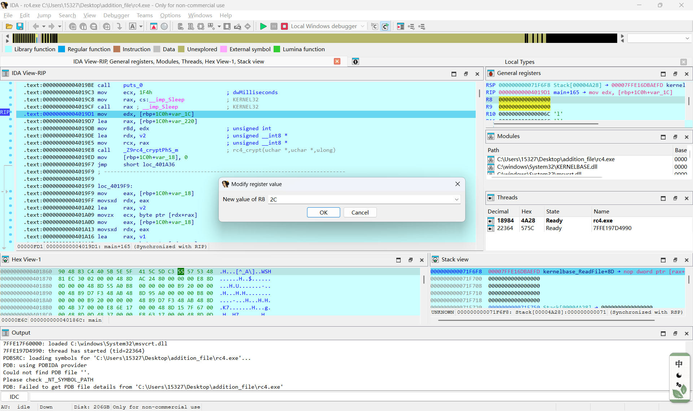
重新尝试，发现执行完rc4_crypt，v1的值已经改变，说明**v1被成功解密了**，把值chr变化就好了  
res = [0x4E, 0x53, 0x53, 0x43, 0x54, 0x46, 0x7B, 0x30, 0x64, 0x36,  
       0x66, 0x39, 0x30, 0x61, 0x63, 0x2D, 0x34, 0x62, 0x35, 0x65,  
       0x2D, 0x34, 0x65, 0x66, 0x62, 0x2D, 0x38, 0x35, 0x30, 0x32,  
       0x2D, 0x36, 0x33, 0x34, 0x39, 0x63, 0x66, 0x37, 0x39, 0x38,  
       0x66, 0x32, 0x65, 0x7D]  
for i in res:  
    print(chr(i), end='')
#### [SWPUCTF 2022 新生赛]贪吃蛇
IDA打开后，对main函数进行反编译，伪代码里有gameStartMenu，gameMainLoop，先分别查看一下两个函数，后一个函数应该是控制游戏进程，判断结果，输出结果等    
查找了半天发现_t_flag疑似是待输出的内容，而前面的校验语句有点复杂。关键是如何通过动态调试跳过校验或者是修改逻辑
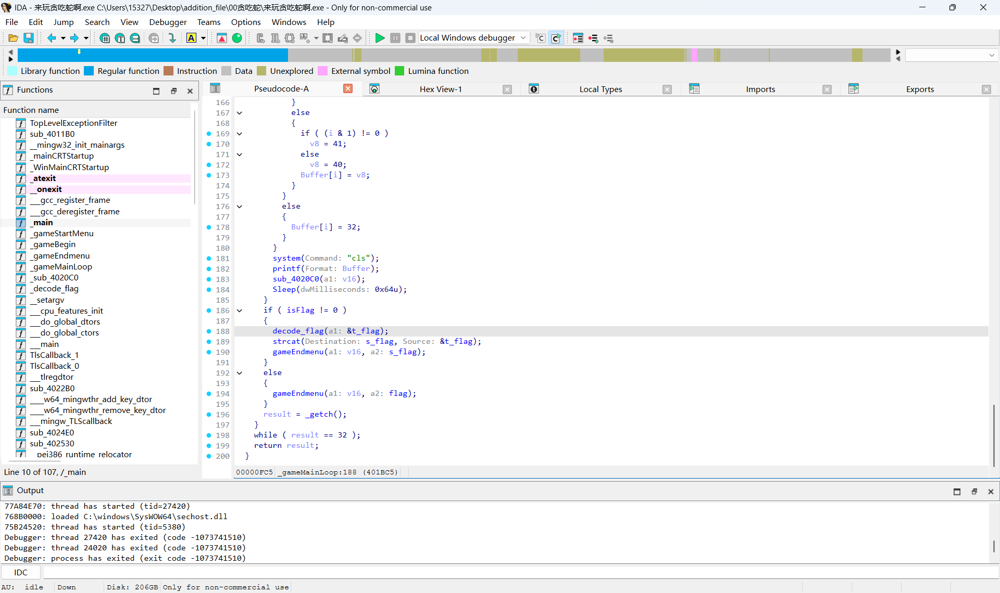
先直接运行观察逻辑，发现jz short loc_401BF3的**跳转语句**，**左边是isflag的输出语句，右边是gameover的语句**，在**jz short loc_401BF3**处下断点，观察运行  
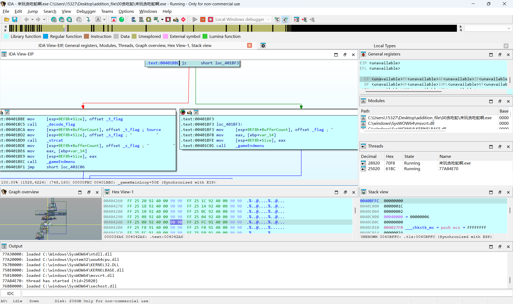
运行直接让蛇死掉，发现程序**执行到jz short loc_401BF3停下了**，此时发现**闪烁的是右边的线段，说明前面的校验结果生效了**
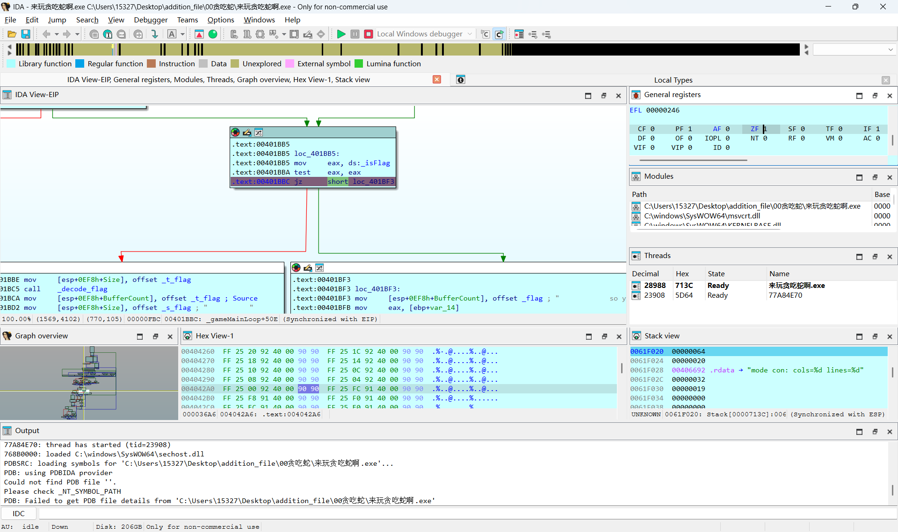
此时可以直接**修改ZF的值**来修改校验结果，此时的ZF为1(校验结果生效)，改成0，会发现**闪烁的是左边的线段，说明修改成功，校验结果已经不生效**。再点运行会输出flag  
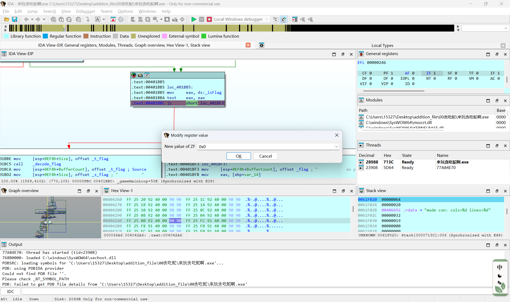
**ZF本身是用于表示判断的结果，在断点处修改ZF等于说直接修改了前面的判断结果，使得程序原本的分支发生变化，执行的模块随之发生改变**
#### [HNCTF 2022 WEEK3]Try2debugPlusPlus
IDA打开，发现函数tea_encrypt，判断考察tea，打开该函数观察加密逻辑，发现其与标准一样，点enc发现有数组，应该对应的是密文
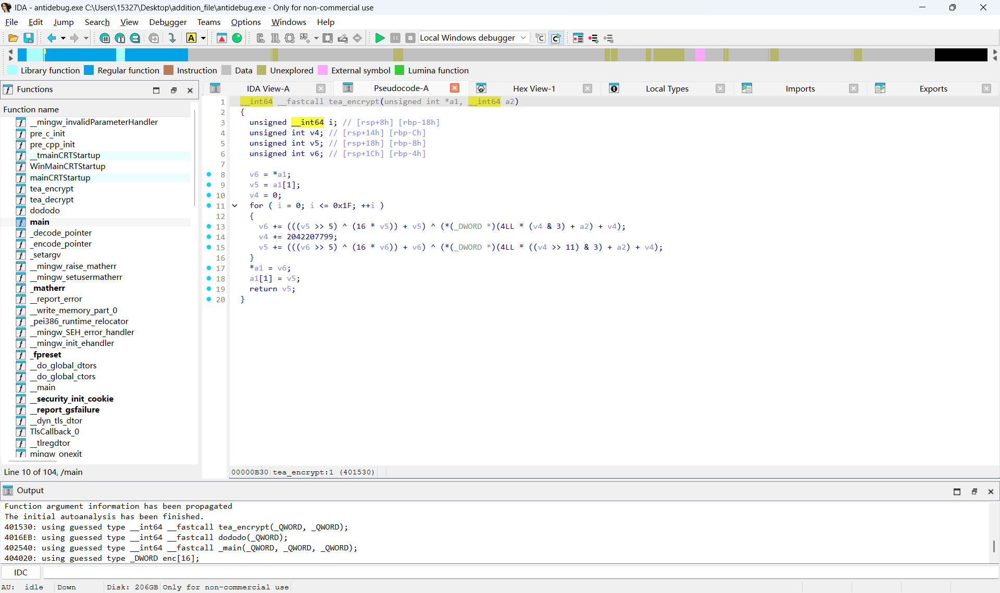
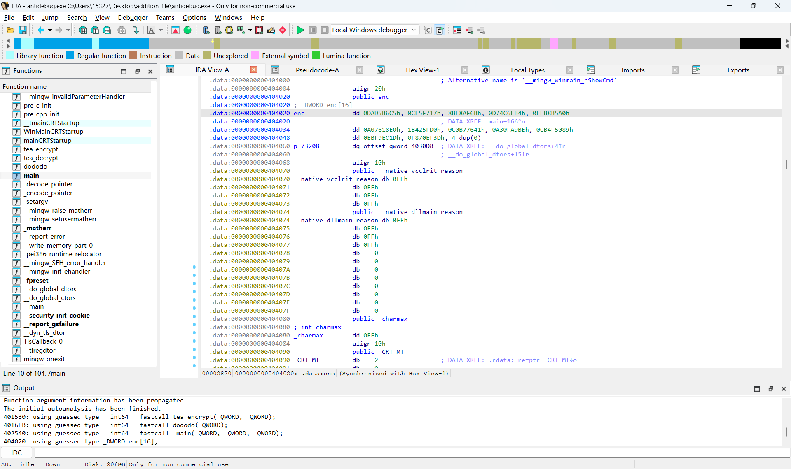
现在不知道的信息是**密钥**，直接使用v6的四个数据，发现是错误的，发现main函数里的 内容似乎和密钥的输出有关,尝试动态调试  
在**main**这里下断点，直接运行发现会退出，主要是**call exit**机器码使得程序退出，为了让退出指令无效，尝试**把该指令nop掉**再运行，发现还不行
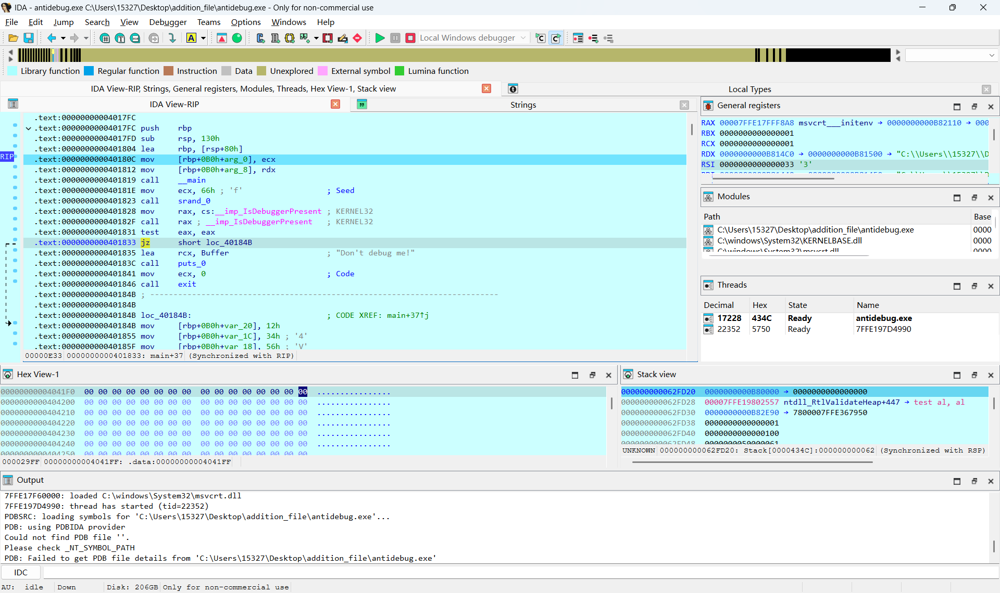
**后面发现jz short loc_401848跳转语句也是无效的，需要把该指令也nop掉，把nop后的一些无效的db也一起nop掉才行**
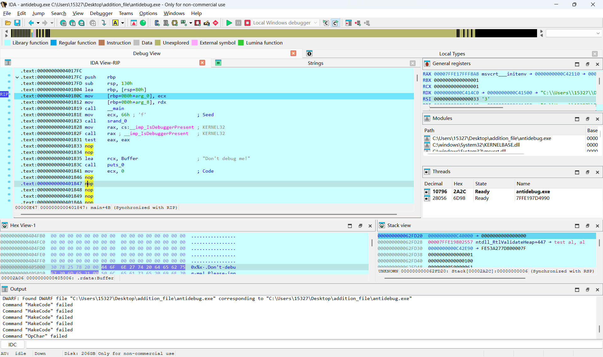
最后处理完在运行，输出了Key:0x91,0x71,0x11,0xbb。这样条件就齐了，可以写对应过来解密的程序了。注意每两组密文进行解密，循环条件，循环次数，一定要写对  
#include <stdio.h>  
#include <string.h>  
#include <stdint.h>  
int main(void)  
{  
    unsigned int a1[]={0x0DAD5B6C5, 0x0CE5F717, 0x8BE8AF6B, 0x0D74C6EB4, 0x0EEB8B5A0, 0x0A07618E0, 0x1B425FD0, 0x0C0B77641, 0x0A30FA9BE,0x0CB4F5089, 0x0EBF9EC1D, 0x0F870EF3D};  
    int a2[] = {0x91,0x71,0x11,0xbb};  
    unsigned int v0,v1,i;  
    for (int k = 0; k < 12; k += 2)  
    {  
        v0 = a1[k];  
        v1 = a1[k + 1];  
        long delta = 0x79B99E37;  
        long sum = (32 * delta);  
        for (i = 0; i <= 31; ++i)  
        {  
            v1 -= (((v0 * 16) ^ (v0 >> 5)) + v0) ^ (sum + a2[(sum >> 11 ) & 3]);  
            sum -= delta;  
            v0 -= (((v1 * 16) ^ (v1 >> 5)) + v1) ^ (sum + a2[(sum & 3)]);  
        }  
        a1[k] = v0;  
        a1[k+1] = v1;  
    }  
    for (i = 0; i < 12; i++)  
    {  
        printf("%c",a1[i]);  
    }  
}
#### [WUSTCTF 2020]level4
IDA打开，反编译后发现left，right，node这些，好像考察的是二叉树，二叉树我已经忘记的差不多了，正好重新温习一遍  
type1,type2两个函数疑似是遍历输出二叉树，还有一个字符串是二叉树处理的对象。没有其他信息了。
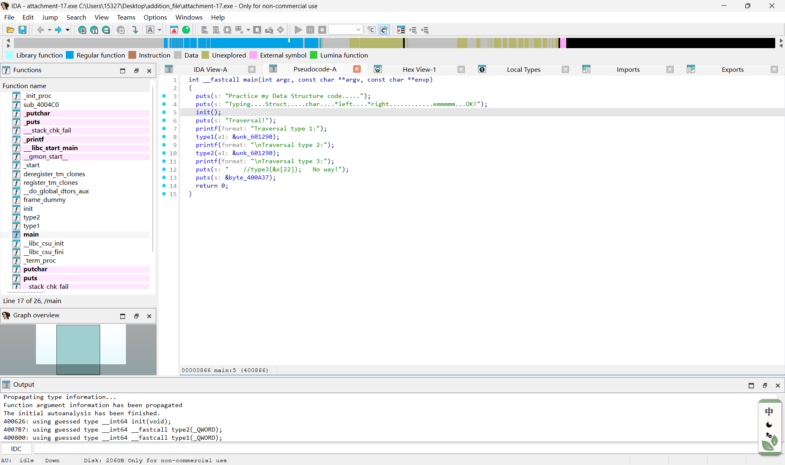
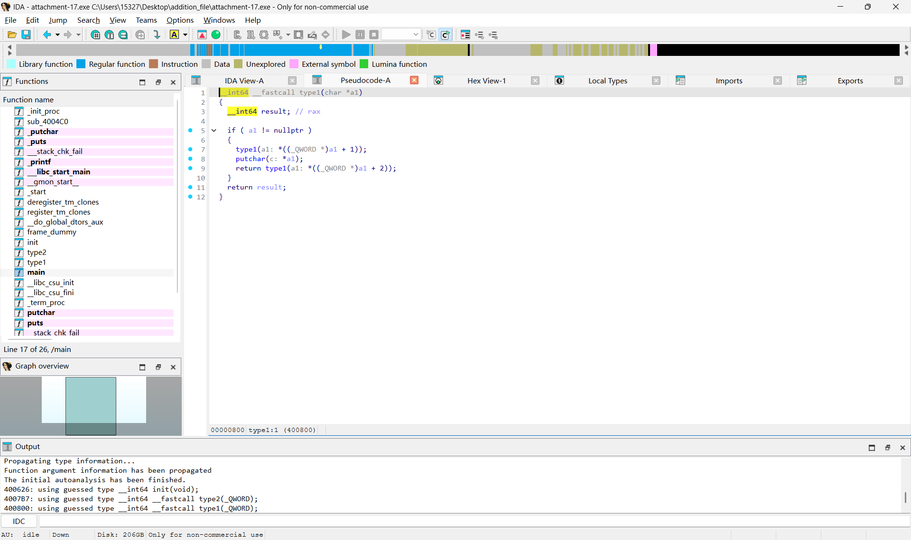
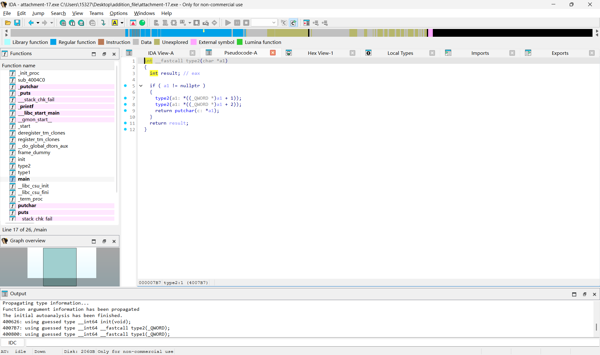
重新查阅有关二叉树的资料，发现特征很明显  
**前序的顺序是:根左右**  
**中序的顺序是:左根右**  
**后序的顺序是:左右根**  
函数的putchar疑似是打印结点，也就是打印根结点。据此判断**type1是中序**，**type2是后序**。但是还不知道输出的结果  
尝试运行文件发现报错，提示**指定的可执行文件不是此操作系统平台的有效应用程序**。发现不对劲，查壳发现这个文件是Linux文件而非windows  
为了完整复现，花了很长时间新建虚拟机，在虚拟机里打开文件并执行它，**输出了type1，type2函数的内容**
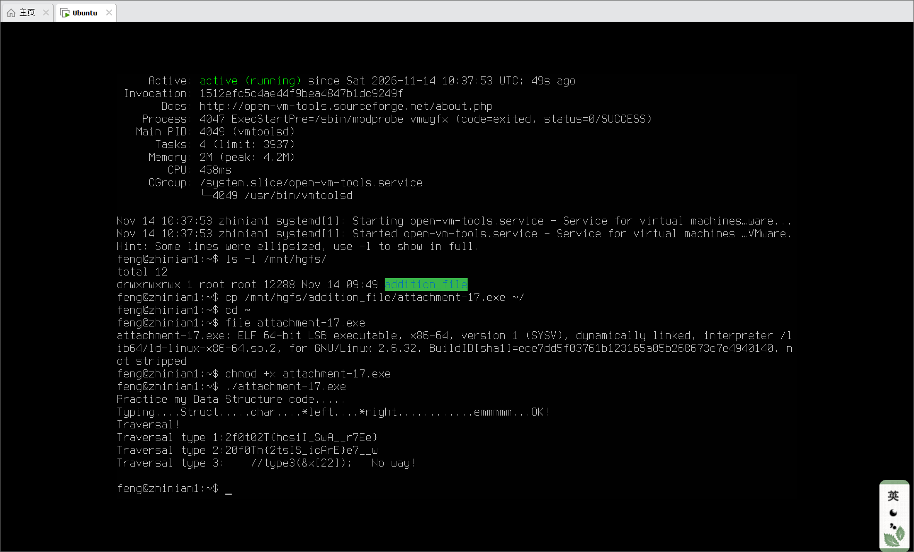
**已知中序遍历的输出，后序遍历的输出，求前序遍历的输出**   
据此写解题代码  * left，* right是左子树，右子树的结点，inStart，int inEnd是中序遍历的起始，结束下标，postStart，int postEnd是后序遍历的起始，结束下标  
if (inorder[i] == postorder[postEnd])是在中序数组中定位根节点的下标，root->left，root->right就是构建左右子树  
#include <stdio.h>  
#include <stdlib.h>  
#include <string.h>  
struct TreeNode   
{
    char val;
    struct TreeNode* left;  
    struct TreeNode* right;  
};
struct TreeNode* buildTree(char* inorder, int inStart, int inEnd, char* postorder, int postStart, int postEnd)   
{  
    if (inStart > inEnd || postStart > postEnd)  
    {  
        return NULL;  
    }  
    struct TreeNode* root = (struct TreeNode*)malloc(sizeof(struct TreeNode));  
    root->val = postorder[postEnd];  
    int i;  
    for (i = inStart; i <= inEnd; i++)  
    {  
        if (inorder[i] == postorder[postEnd])  
        {  
            break;  
        }  
    }  
    root->left = buildTree(inorder, inStart, i - 1, postorder, postStart, postStart + i - inStart - 1);  
    root->right = buildTree(inorder, i + 1, inEnd, postorder, postStart + i - inStart, postEnd - 1);  
    return root;  
}  
void preOrder(struct TreeNode* root)   
{  
    if (!root)   
    {  
        return;  
    }  
    printf("%c", root->val);  
    preOrder(root->left);  
    preOrder(root->right);  
}  
int main()  
{  
    char inorderStr[] = "2f0t02T{hcsiI_SwA__r7Ee}";  
    char postorderStr[] = "20f0Th{2tsIS_icArE}e7__w";  
    int n = strlen(inorderStr);  
    struct TreeNode* root = buildTree(inorderStr, 0, n - 1, postorderStr, 0, n - 1);  
    printf("前序遍历: ");  
    preOrder(root);  
    return 0;  
}  
[HNCTF 2022 Week1]Little Endian
没有想到在这里被大小端序绕晕了  
IDA打开后，直观的能看到**异或**操作**enc[i] ^ 0x12345678**，enc的值也有，但是shift E 提取数据时发现**字节顺序倒置**了，然后写程序时发现**0x12345678**,**字节顺序也必须倒置**，正序异或结果居然不对 
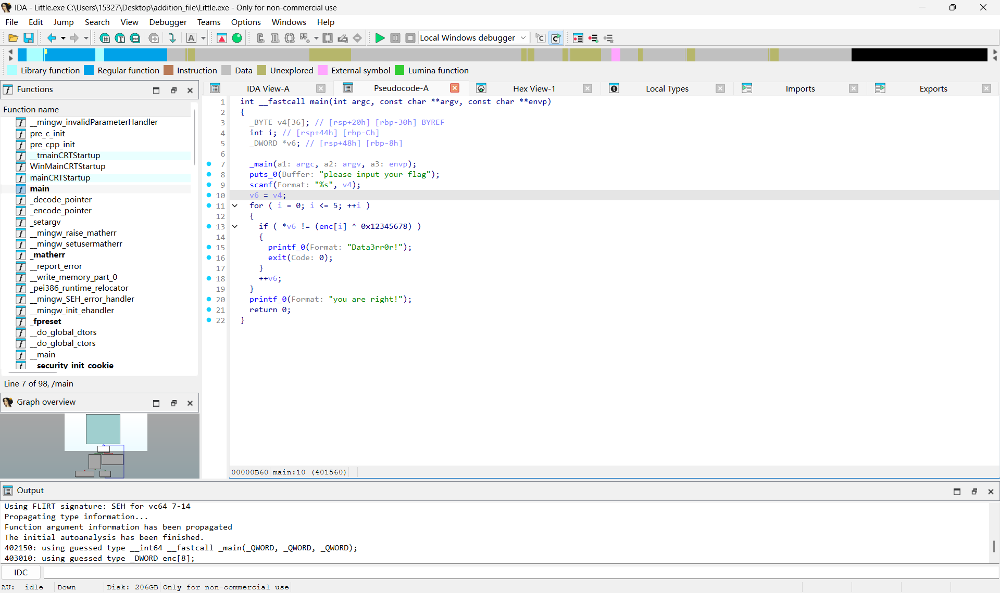
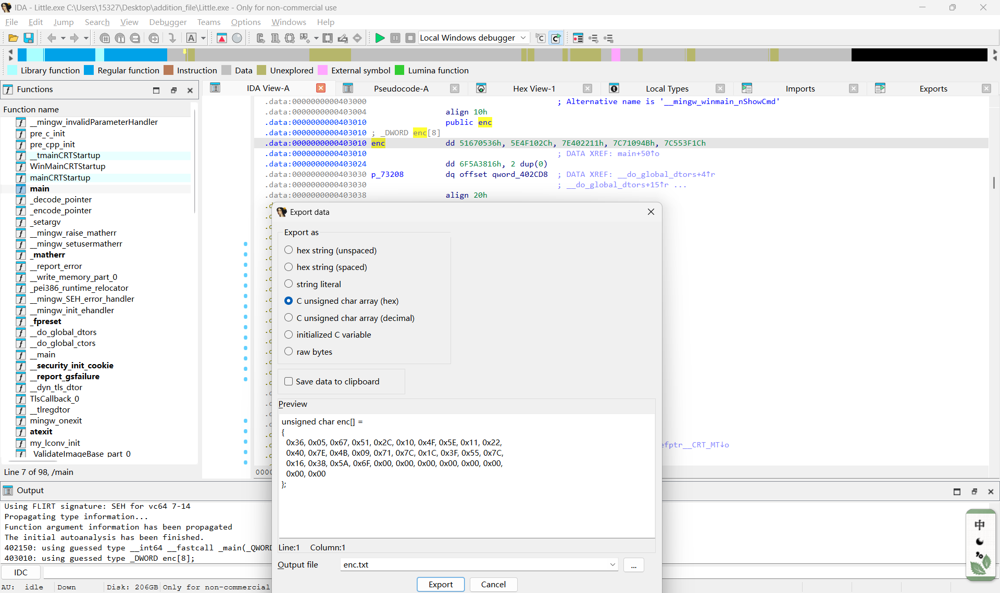
**因为Hex View 显示的是内存字节顺序(代码把其当成了字节数组)，不是大端序。提取数据时是按照内存地址从低到高，逐个原始字节导出的，完全遵照二进制本身的顺序(小端)**
**IIDA 里显示的大数写法是数值呈现方式，而不是真实的存储**，0x12345678，enc的数组51670536等等都一样，所以提取时必须注意**大小端序**的问题
enc=[  
  0x36, 0x05, 0x67, 0x51, 0x2C, 0x10, 0x4F, 0x5E, 0x11, 0x22,   
  0x40, 0x7E, 0x4B, 0x09, 0x71, 0x7C, 0x1C, 0x3F, 0x55, 0x7C,   
  0x16, 0x38, 0x5A, 0x6F, 0x00, 0x00, 0x00, 0x00, 0x00, 0x00,   
  0x00, 0x00]  
a=[0x78,0x56,0x34,0x12]  
value=''  
for i in range(0,len(enc)):  
    value+=chr(enc[i]^a[i%len(a)])  
print(value) 
