# 第一节 基本工具的安装与使用
## 一、工具安装

### 1.Hackbar
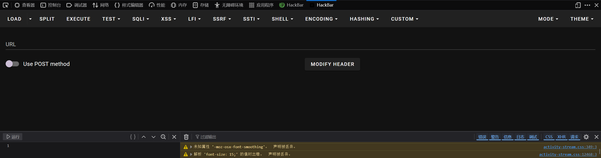
### 2.Brup suite
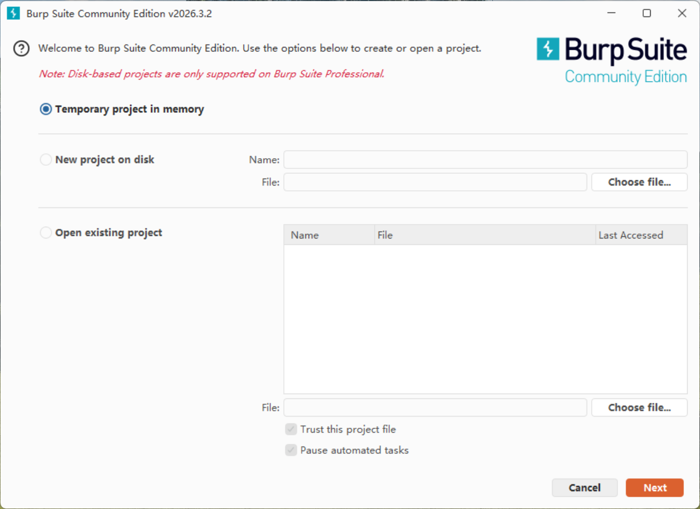
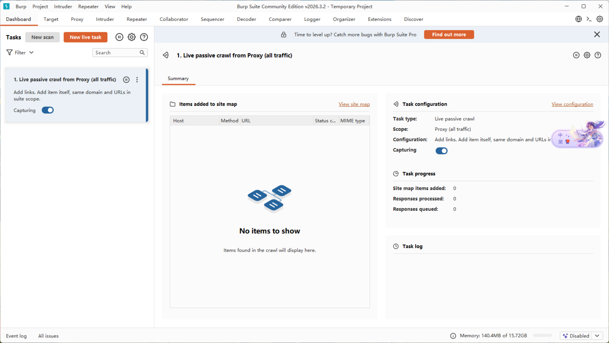
### 3.dirsearch
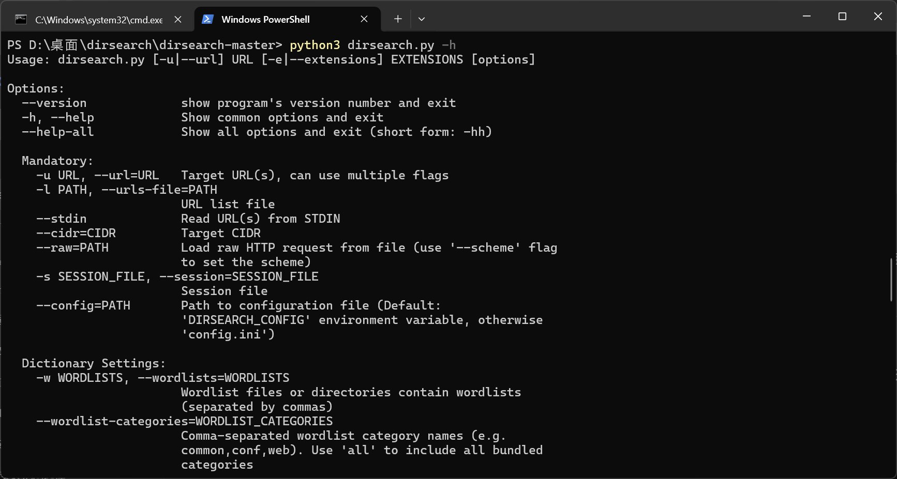


## 二、题目

### 1.[SWPUCTF 2021 新生赛]gift_F12
按F12查看源代码，搜索flag
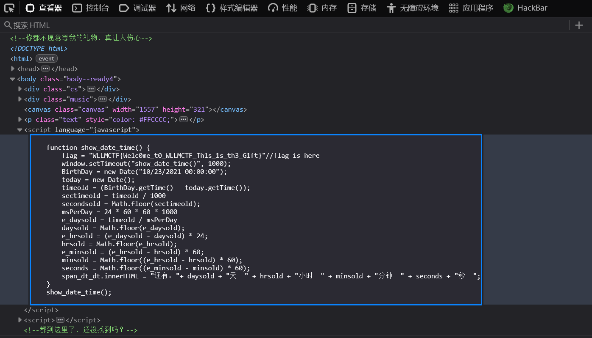
修改格式提交

### 2.[qsnctf-NO.0902]robots.txt
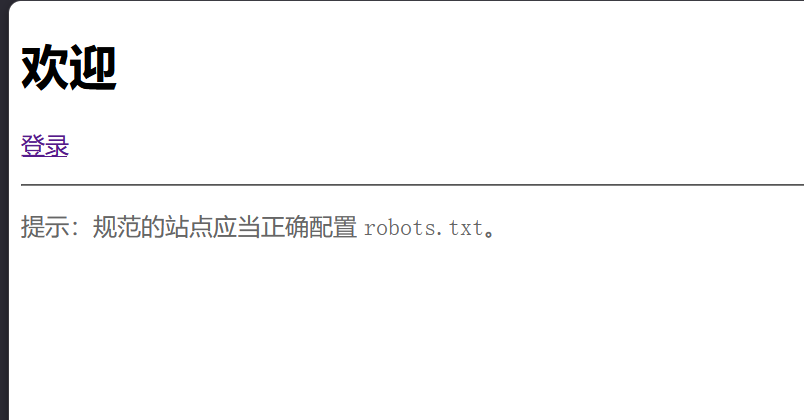
根据提示想到URL后面加上/robots.txt，访问这个文件
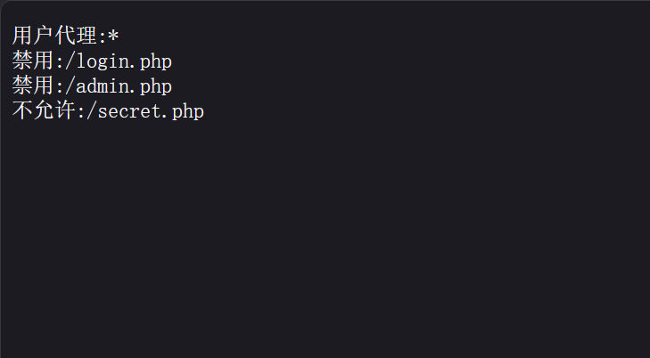
同样的，访问secret.php
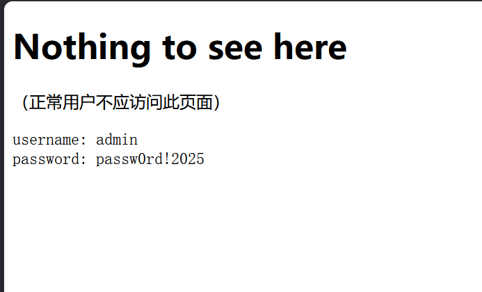
输入得正确flag
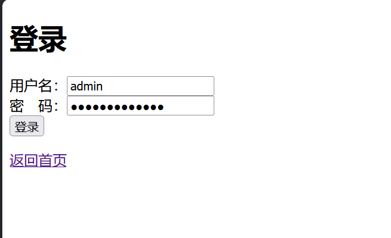
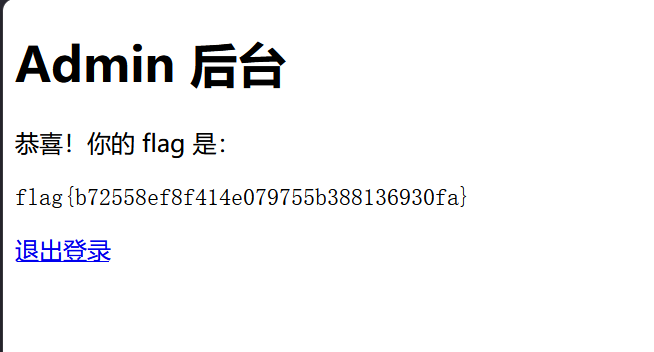

### 3.[MoeCTF 2021]Web 安全入门指北—GET
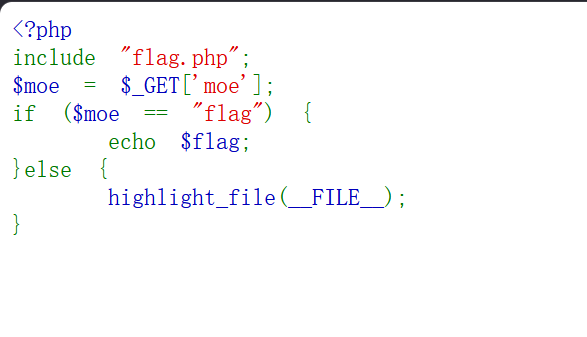
这段代码是要传入一个GET参数moe，并且它的值等于“flag”,在URL后面加?moe=flag，得到flag值
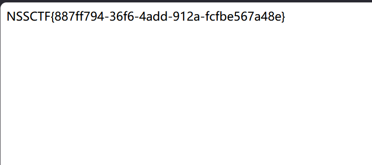


# 第二节 Linux 操作系统

## 一、搭建Linux环境
### 在PS中执行
`wsl --install`
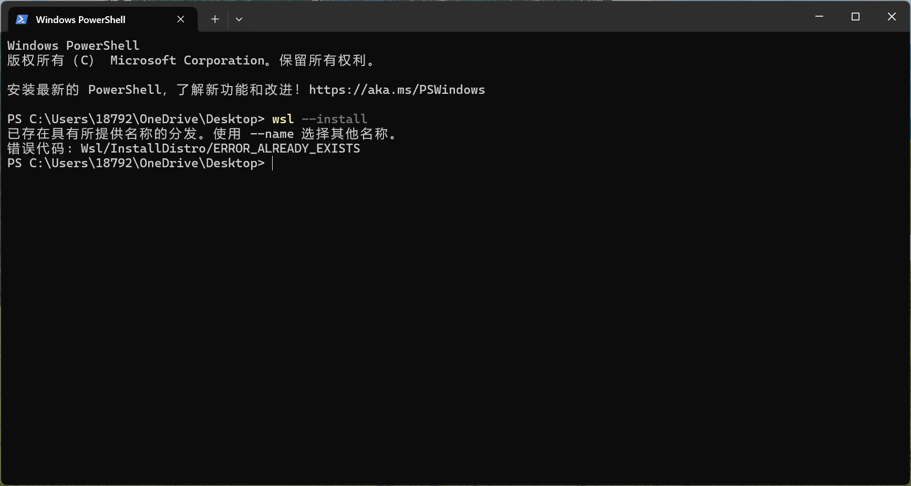
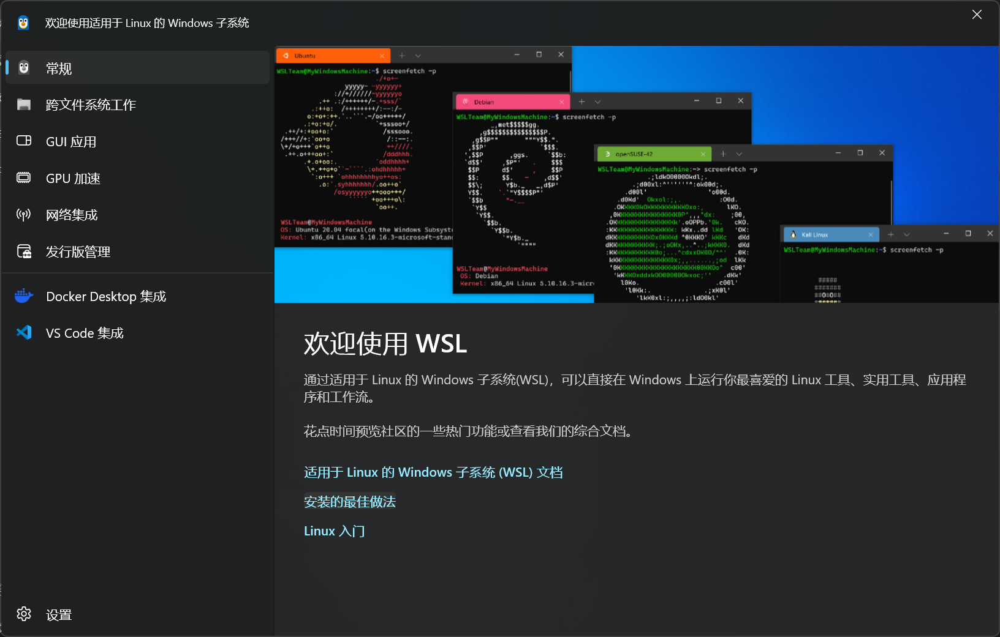

## 二、linux基本命令
### 1.文件与目录操作（最常用）

| 命令 | 作用 | 常用示例 |
| :--- | :--- | :--- |
| `pwd` | 显示当前所在目录的完整路径 | `pwd` → `/home/huoshan` |
| `ls` | 列出当前目录下的文件和文件夹 | `ls -la` (显示隐藏文件及详细信息) |
| `cd` | 切换目录 | `cd /mnt/c/Users` (进入Windows目录)<br>`cd ~` (回家目录)<br>`cd ..` (返回上一级) |
| `mkdir` | 创建新目录 | `mkdir my_project` |
| `touch` | 创建空白文件，或更新文件时间戳 | `touch readme.txt` |
| `cp` | 复制文件或目录 | `cp file1.txt backup/`<br>`cp -r folder1 folder2` (复制文件夹需加 `-r`) |
| `mv` | 移动/重命名文件或目录 | `mv old.txt new.txt` (重命名)<br>`mv file.txt ~/Documents/` (移动) |
| `rm` | 删除文件或目录 | `rm file.txt`<br>`rm -rf folder/` (强制递归删除，**高危操作，慎用**) |
| `cat` | 查看文件内容（一次性输出全部） | `cat /etc/os-release` |
| `less` / `more` | 分页查看文件内容（按 `q` 退出） | `less /var/log/syslog` |
| `head` / `tail` | 查看文件开头/结尾几行 | `tail -f /var/log/syslog` (实时追踪日志) |

###  2.权限与用户管理

| 命令 | 作用 | 常用示例 |
| :--- | :--- | :--- |
| `sudo` | 以超级管理员权限执行命令 | `sudo apt update` |
| `chmod` | 修改文件/文件夹的读写执行权限 | `chmod +x script.sh` (给脚本加执行权限)<br>`chmod 755 folder` |
| `chown` | 修改文件所属用户和组 | `sudo chown huoshan:huoshan file.txt` |
| `whoami` | 查看当前登录的用户名 | `whoami` → `huoshan` |
| `passwd` | 修改用户密码 | `passwd` |

###  3.系统管理与进程

| 命令 | 作用 | 常用示例 |
| :--- | :--- | :--- |
| `ps` | 查看当前运行的进程状态 | `ps aux` (显示所有进程详细信息) |
| `top` / `htop` | 动态实时显示系统资源占用（按 `q` 退出） | `top` |
| `kill` | 终止指定进程 | `kill -9 1234` (强制终止 PID 为 1234 的进程) |
| `systemctl` | 管理系统服务（Systemd） | `sudo systemctl status ssh`<br>`sudo systemctl restart networking` |
| `df` | 查看磁盘分区使用情况 | `df -h` (人类可读的 GB/MB 显示) |
| `du` | 查看某个目录或文件占用空间大小 | `du -sh *` (查看当前目录各文件/夹总大小) |
| `free` | 查看内存使用情况 | `free -h` |
| `uname` | 查看系统内核版本信息 | `uname -a` |

###  4.网络与下载

| 命令 | 作用 | 常用示例 |
| :--- | :--- | :--- |
| `ping` | 测试网络连通性 | `ping google.com` |
| `curl` | 命令行下的 URL 传输工具（发请求/下载） | `curl http://example.com`<br>`curl -O https://file.zip` |
| `wget` | 下载文件 | `wget https://wordpress.org/latest.zip` |
| `ip` | 查看/配置网络接口（现代替代 `ifconfig`） | `ip addr show` (查看 IP 地址) |
| `ssh` | 远程登录服务器 | `ssh user@192.168.1.100` |

###  5.软件包管理

WSL使用的是 `apt` 包管理器。
| 命令 | 作用 |
| :--- | :--- |
| `sudo apt update` | 更新软件源列表 |
| `sudo apt upgrade` | 升级所有已安装的软件包 |
| `sudo apt install <包名>` | 安装软件（如 `sudo apt install git`） |
| `sudo apt remove <包名>` | 卸载软件（保留配置文件） |
| `sudo apt purge <包名>` | 彻底卸载软件（含配置文件） |
| `apt search <关键词>` | 搜索软件包 |

###  6.进阶效率技巧（管道与通配符）

这是 Linux 命令行的灵魂，可以把简单命令组合成复杂操作。

1.  **管道符 `|`**：将前一个命令的输出，作为后一个命令的输入。
    ```bash
    # 查看包含 "ssh" 关键字的进程
    ps aux | grep ssh
    ```

2.  **重定向 `>` 和 `>>`**：
    ```bash
    # 将 echo 输出的内容写入文件（覆盖）
    echo "Hello" > file.txt
    # 将内容追加到文件末尾（不覆盖）
    echo "World" >> file.txt
    ```

3.  **通配符 `*`**：
    ```bash
    # 列出所有以 .txt 结尾的文件
    ls *.txt
    # 删除所有 .log 文件
    rm *.log
    ```
 
