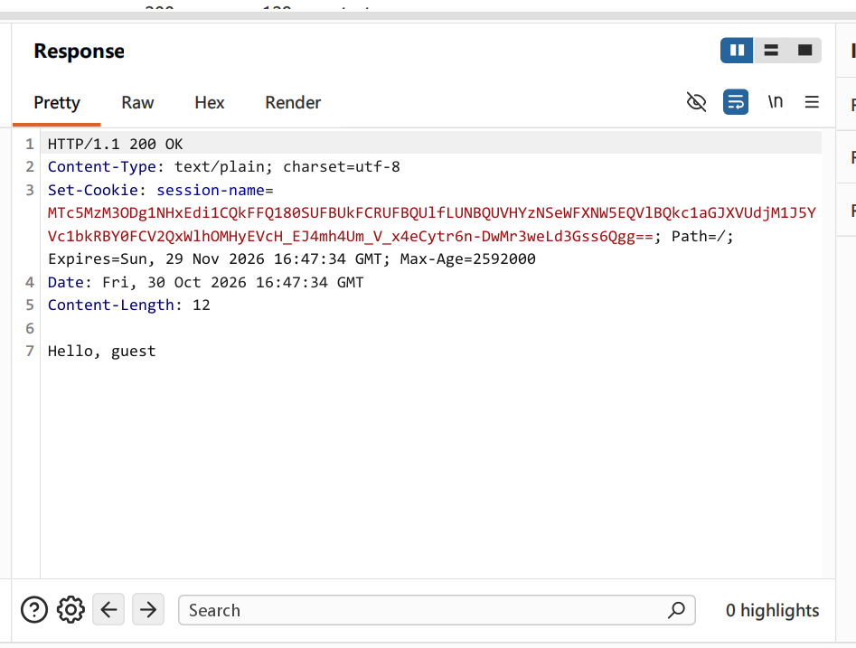
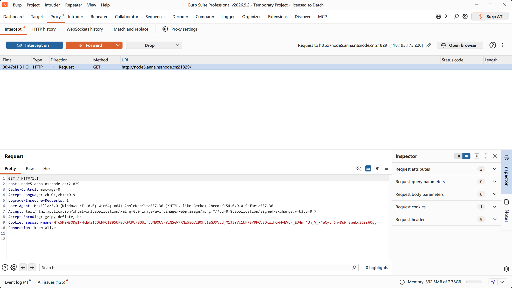

# Web 方向 week3 作业 · session 值初步

| 项目 | 内容 |
| --- | --- |
| ID | gofkurself |
| 年级-方向 | 26-web |
| 周次 | week3（10.26 - 11.1） |
| 完成日期 | 2026-10-31 |
| 任务来源 | [培训文档](https://hnusec-star.feishu.cn/wiki/U2xfwfP39iWhISkZOa4c1UtInxd) · web 技术文档 session 值初步 |

## 第三节 session 值初步

### 3.1 session 是什么

- 解决什么问题：区分不同用户的不同会话
- sessionid 存在哪、session 内容存在哪：
sessionid存在用户端浏览器 session内容在服务端
- cookie / session / sessionid 三者的关系：
cookie是用来鉴别用户身份 区分用户的 session是当前用户会话的上下文 保存在服务器 sessionid保存在用户端 只是一个ID 回传服务器用来区分用户并获取内容
- 和 JWT 最本质的区别（谁保存状态）：
JWT的状态保存在客户端 session的内容保存在服务端
- 为什么说它"不加密也不编码"，只是一个随机串：
客户端能接触到的与session有关的东西就是一个随机生成的sessionid便于服务器区分用户

### 3.2 一次登录里 session 怎么走

1. 用户浏览器请求网页
2. 服务器创建会话 分配sessionid
3. sessionid存储在cookie中 发送请求时携带cookie
4. 服务端验证sessionid获取会话数据
5. 用户退出或会话过期 服务端清除会话数据和cookie
- 服务端 session 一般存在哪，各自的问题：
内存: 读写极快, 但分布式服务的支持差, 可靠性差
本地文件: 读写快, 分布式服务支持差, 可靠性较好
Redis: 读写快, 分布式支持优秀(Redis的特性), 可靠性优秀(集群)
数据库:读写延迟偏慢 分布式支持良好 可靠性极高
- 为什么会话过期、重启服务就掉登录：
session过期后session内容被清理 sessionid失效
session内容存在RAM中 重启服务后被清理 自然失效

### 3.3 亲手看一眼（一步一图）

#### 步骤 1：登录请求的响应头

#### 步骤 2：下一次请求带上的 Cookie

- 两次的 sessionid 是不是同一个：是

#### 步骤 3：把 sessionid 改一位再发

- 现象和原因：cookie失效 原始session经过签名 篡改会被破坏

### 3.4 cookie 关键属性

| 属性 | 作用 |
| --- | --- |
| `HttpOnly` | 阻止通过JavaScript访问cookie防范XSS |
| `Secure` | 仅通过https传输 |
| `SameSite` | 控制跨域请求是否发送cookie来防范CSRF |
| `Domain` / `Path` | 指定cookie可以送达的主机与路径 |
| `Expires` / `Max-Age` | 规定有效期 |

### 3.5 session 和 JWT 怎么选

| 维度 | session | JWT |
| --- | --- | --- |
| 状态存在哪 | 服务器 | 客户端 |
| 服务端压力 | 大 | 小 |
| 跨域 / 多服务 | 支持弱 | 兼容优秀 |
| 能不能主动注销 | 能 | 不能 |
| 客户端能不能看到内容 | 不能 | 能 |
| 出问题时的攻击点 | 旧session未吊销 被攻击者利用 | 明文储存数据, 弱口令, 公钥 |

### 3.6 三个概念（python 漏洞那节会用到，这里只记定义）

- 会话固定：借助他人用相同的会话ID获取认证和授权，然后利用该会话ID劫持他人的会话以冒充他人
- 会话劫持：MITM攻击(类似Burp的Intercept)
- session 伪造靠什么：Flask 中只对 Session 进行了签名 没有加密
