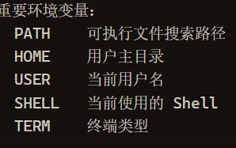

# 26\-web\- hxcyy\.11\.13\.md 

# 碎碎念：本来想找一些题目练练，但发现有关Linux系统的题目都包含一些其他模块的知识，实在看不懂（悲伤ing\)所以就先学习了解了一些基本知识\.\.\.\.

# 一：什么是Linux系统

Linux指的是系统内核，而我们常说的 Linux指的是 “发行版完整的包含一些基础软件的操作系统

# 二：终端连接远程服务器

方法：在shell的执行环境下执行“ssh 用户名@远程服务器的IP地址”命令，然后输入服务器的连接密码就可以在本地电脑操作远程服务器。

# 三、shell

## 1\.定义：

用户跟内核交互的对话，Shell是一个程序，提供一个与用户对话的环境。这个环境只有一个命令提示符，让用户从键盘输入命令，所以又称为命令行环境（command line interface，简写为CLI）。Shell 接收到用户输入的命令，并对命令进行解释，将命令送入操作系统执行，并将结果返回给用户。用户可以用Shell命令写出各种小程序，又称为Shell脚本。这些脚本都通过Shell的解释执行，而不通过编译。

## 2\.分类：

- Bourne Shell（sh）

- Bourne Again shell（bash）

- C Shell（csh）

- TENEX C Shell（tcsh）

- Korn shell（ksh）

- Z Shell（zsh）

- Friendly Interactive Shell（fish）

可以通过执行echo $SHELL命令可以查看到当前正在使用的Shell。还可以通过cat /etc/shells查看当前系统安装的所有Shell种类

## 3\.命令

### （1）命令行提示符：

提示符往往是一串前缀，最后以一个美元符号$ 结尾，用户可以在这个符号后面输入各种命令。

我的命令行提示符：lenovo@LAPTOP\-OH6IBM3B：\~$

- lenovo表示我的用户名

- @为分隔符，是个固定的写法

- LAPTOP\-OH6IBM3B是我的主机名

- \~：表示目前所在目录为家目录，其中root用户的家目录是 /root普通用户的家目录在 /home 下

- \#：指示你所具有的权限（root用户为\# ，普通用户为$）。

- 执行whoami命令可以查看当前用户名；

- 执行hostname命令可以查看当前主机名；

### （2）命令格式

命令 参数

（补充参数的作用：用来修改，补充命令，对命令附加要求）

### （3）常用的长短参数

|短参数|长参数|含义|
|---|---|---|
|\-a|\-\-all|显示全部文件（含隐藏）|
|\-r|\-\-reverse|反向排序|
|\-p|\-\-port|指定端口|
|\-l||显示详细列表|
|\-h|\-\-human\-readable|以人类易读方式显示大小|
|\-t||按修改时间排序，最新的在前|
|\-i|\-\-inode|显示文件的 inode 号|

### \(4\)参数值

参数的操作的具体内容

# 四、快捷方式

- 通过上下方向键 ↑ ↓ 来调取过往执行过的Linux命令；

• 命令或参数仅需输入前几位就可以用 Tab 键补全；

• Ctrl \+ R ：用于查找使用过的命令（history命令用于列出之前使用过的所有命令，然后输入\!命令加上编号 \(\!2\) 就可以直接执行该历史命令）；

• Ctrl \+ L：清除屏幕并将当前行移到页面顶部；

• Ctrl \+ C：中止当前正在执行的命令；

• Ctrl \+ U：从光标位置剪切到行首；

• Ctrl \+ K：从光标位置剪切到行尾；

• Ctrl \+ W：剪切光标左侧的一个单词；

• Ctrl \+ Y：粘贴Ctrl \+ U \| K \| Y剪切的命令；

• Ctrl \+ A：光标跳到命令行的开头；

• Ctrl \+ E：光标跳到命令行的结尾；

• Ctrl \+ D：关闭Shell会话；

# 五、文件和目录

### （1）文件的组织

### （2）查看路径

**pwd**:显示当前目录的路径

**which**：查看命令的可执行文件所在路径

格式：which 命令

## **（3）浏览和切换目录**

**ls**:列出文件和目录

**cd**：表示切换目录

**cd /path** 为切换到绝对路径（绝对路径：从根目录开始写的完整路径，以/开头）​

（相对路径为以当前目录为起点去找文件，不以/开头）​

**du**:列举目录大小信息

**常用参数**

• \-h 适合人类阅读的；

• \-a同时列举出目录下文件的大小信息；

• \-s只显示总计大小，不显示具体信息

## （4）浏览和创建文件

**cat**：一次性显示文件所有内容，更适合查看小的文件

常用cat file1 file2连续查看两个文件

**常用参数**

\-n 表示行号

less：分页显示文件内容，更适合查看大的文件

**快捷键**

- 空格键：前进一页（一个屏幕）；

• b 键：后退一页；

• 回车键：前进一行；

• y 键：后退一行；

• 上下键：回退或前进一行；

• d 键：前进半页；

• u 键：后退半页；

• q 键：停止读取文件，中止less命令；

• = 键：显示当前页面的内容是文件中的第几行到第几行以及一些其它关于本页内容的详细信息；

• h 键：显示帮助文档；

• / 键：进入搜索模式后，按 n 键跳到一个符合项目，按 N 键跳到上一个符合项目，同时也可以输入正则表达式匹配。

**head**：显示文件的开头几行（默认是 10 行）

**参数**

\-n 指定行数

**tail：**显示文件的结尾几行（默认是 10 行）

**参数**

\-n指定行数

\-f会每过 1 秒检查下文件是否有更新内容，也可以用 \-s 参数指定间隔时间

**touch**：创建一个文件

**mkdir**：创建一个目录

mkdir  \-p /a/b/c递归创建目录

### （5）文件的复制和移动

**cp：**拷贝文件和目录

cp 源 目标 

cp file1 file2 复制文件 

cp \-r dir1 dir2 递归复制目录 

cp \-i 复制前向用户确认

**补充：**cp的规则

1\. cp file one

\(1\)若one已存在，而且是文件夹，file将被放入one这个文件夹里

（2）若one不存在，one将作为file的新名字

（3）若one为已存在的文件，file将覆盖掉one

2\.cp file one/file\-copy

是将file这个文件移动到one里，并重新命名为file\-copy

3\.cp \*\.txt folder

将所有名字以\.txt结尾的文件复制到folder文件夹里

**参数**

\-r递归的拷贝，常用来拷贝一整个目录

**mv**：移动（重命名）文件或目录，与 cp 命令用法及规则相似，注意mv是移动，而cp是复制

### （6）文件的删除和链接

**rm**：删除文件和目录

rm file为删除file文件

rm f1 f2 f3 为同时删除f1，f2，f3文件

- \-i 向用户确认是否删除；

• \-f文件强制删除；

• \-r递归删除文件，通常还会向客户确认是否删除

- rm \-rf为强制递归删除文件夹

**ln**：英文 Link 的缩写，表示创建链接

whoami查看当前登录的用户名

### （7）显示文件

**head**

head \-n 20 file 显示前20行

head \-c 100 file 显示前100个字节

**tail**

tail \-n 20 file显示最后20行

tail \-f file 实时追踪文件变化

**grep**

搜索文本

### （8\)文件的权限

**ls \-la** 

查看文件权限

**chmod**

修改文件权限

4=r\-\-仅读

2=\-w\-仅写

1=\-\-x仅执行

数字的三位分别对应 所有者、同组用户、其他用户

chmod 数字 文件名

### （9）系统信息

**uname**

显示系统内核信息

uname \-a显示所有信息

uname \-r显示内核版本

uname \-m显示系统架构

**df \-h**

查看磁盘空间

（关注Use%列，超过80%可能影响系统性能）

**free \-h**

显示内存使用情况

**ps**

查看进程

a\-显示所有用户的信息

u\-显示详细用户的信息

x\-显示无控制终端的进程

**pgrep**

查找进程

### （10）网络排查

**ip addr**

显示网络接口及IP地址信息

**ping** 

测试网络连通性

### （11）环境变量

**env**

查看所有环境变量

**查看PATH环境变量**

echo $PATH

换源配置（将下载源从官方服务器切换到国内镜像）

### （12）文件的查找与查看

**wc**统计文件

**find**查找文件

**more**分页查看文件

**tac**反向查看文件

### （13）重定向与反重定向

echo输出**重定向**（'\>'是输出重定向符）

echo 命令 \> file

**追加重定向**

echo 命令 \>\> file

### （14）查看用户信息

**whoami**查看当前登录的用户名

